# Philosophies, Methodologies & Practices

Where the ideas came from, and who to read. This page traces the *lineage* of how the industry builds software — each entry gives the origin story and a primary source. For the day-to-day application of these ideas, see [Design Principles](principles.md) and [Lifecycle](lifecycle.md).

```
Philosophy   — mindset & values
  └── Methodology — how you organize your team & process
        └── Practice — specific techniques while coding
              └── Design approach — how you model and structure code
```

---

## Philosophies ( The why and what to believe )

### 1. Systems Thinking

> _"A system is more than the sum of its parts."_

Before you fix a team, a service, or a process, step back and look at the whole. A faster development team means nothing if deployment is still a bottleneck. A brilliant individual component can make the overall system worse if it shifts the problem somewhere else. Systems Thinking teaches you to ask "what does the whole look like?" before touching any one part.

**Ref:** Peter Senge, [_The Fifth Discipline_](https://en.wikipedia.org/wiki/The_Fifth_Discipline) (1990)

---

### 2. Lean

> _"The most dangerous kind of waste is the waste we do not recognize."_ — Shigeo Shingo

Toyota discovered in the 1950s that most time in any production process is not spent making things — it's spent waiting, fixing mistakes, and building things nobody asked for. Lean is the discipline of making that invisible waste visible, then relentlessly cutting it. When it crossed into software, it became the foundation for Agile, Kanban, and DevOps.

**Ref:** Toyota Production System; [_Lean Software Development_](https://www.amazon.com/Lean-Software-Development-Agile-Toolkit/dp/0321150783) — Mary & Tom Poppendieck (2003)

---

### 3. Agile ( Able to move quickly and change direction without losing balance )

> _"Responding to change over following a plan."_ — Agile Manifesto

In 2001, seventeen developers gathered at a ski lodge in Utah, frustrated by years of big upfront plans that crumbled on contact with reality. What they wrote — the Agile Manifesto — was a bet that short cycles, real working software, and continuous customer feedback would beat any rigid specification. It changed how the industry thinks about software delivery.

**Ref:** [Agile Manifesto](https://agilemanifesto.org/) (2001)


**How the frameworks relate:** Agile is a set of values, not a process. Scrum, Kanban, XP, Shape Up, and SAFe are frameworks that put those values into practice. Kanban also draws directly on Lean.

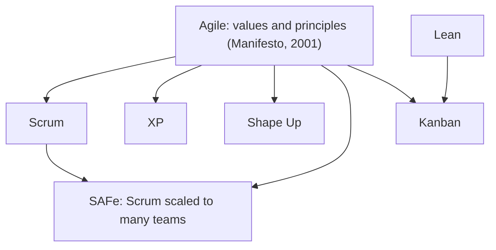

---

### 4. DevOps

> _"You build it, you run it."_ — Werner Vogels, Amazon CTO

For decades, developers wrote code and handed it to a separate operations team to deploy. When things broke in production, nobody fully owned the problem. DevOps tore down that wall — the team that builds a service is also responsible for running it. The result is faster feedback, shared accountability, and systems designed with failure already in mind.

**Ref:** [_The Phoenix Project_](https://itrevolution.com/product/the-phoenix-project/) — Gene Kim (2013); [_Accelerate_](https://itrevolution.com/product/accelerate/) — Nicole Forsgren (2018)

**Practical detail:** [CI/CD Platforms](../tool_tip/cicd.md) · [Running a Server](../tool_tip/server_operations.md)

---

### 5. Unix Philosophy

> _"Write programs that do one thing and do it well."_ — Doug McIlroy

When Ken Thompson and Doug McIlroy built Unix at Bell Labs in the 1970s, they made a deliberate choice: keep every tool small, focused, and composable. `grep` finds text. `sort` orders lines. `curl` fetches URLs. None of them try to do more. Together, through pipes, they can do almost anything. That same idea lives on today in microservices — small services, clear boundaries, simple interfaces.

**Ref:** Doug McIlroy, [_The Art of Unix Programming_](http://www.catb.org/~esr/writings/taoup/) — Eric S. Raymond (2003)

---

### 6. Separation of Concerns (SoC)

> _"The art of programming is the art of organizing complexity."_ — Edsger Dijkstra

A system becomes hard to understand the moment different kinds of work start bleeding into each other — when a function that fetches data also formats it for display, or when payment logic lives alongside authentication. Separation of Concerns is the discipline of keeping distinct responsibilities in distinct places, so you can change one without disturbing the others.

**Ref:** Edsger Dijkstra, [_On the role of scientific thought_](https://www.cs.utexas.edu/~EWD/transcriptions/EWD04xx/EWD447.html) (1974)

**Practical detail:** [Design Principles → Other Principles](principles.md#other-principles-worth-knowing) · [Architecture](architecture.md)

---

### 7. Convention over Configuration (CoC)

> _"Rails is omakase."_ — DHH

When David Heinemeier Hansson released Ruby on Rails in 2004, he noticed that developers were spending enormous energy making trivial decisions — what to name a table, where to put a file, how to structure a route. Convention over Configuration says: a good framework should make those decisions for you. You configure only what makes your app genuinely unique, and trust the framework for everything else.

**Ref:** David Heinemeier Hansson, [Ruby on Rails](https://rubyonrails.org/) (2004)

**Practical detail:** [Design Principles → Other Principles](principles.md#other-principles-worth-knowing)

---

### 8. SOLID

> _"Write code so that when you change one thing, only that one thing changes."_

Robert C. Martin distilled decades of painful object-oriented lessons into five principles that keep code changeable over time. Violate them and the codebase slowly becomes a place where every change breaks something unexpected.

| | Principle | Meaning | Fights against |
|---|---|---|---|
| **S** | Single Responsibility | One class, one job | One change affects unrelated things |
| **O** | Open/Closed | Extend without modifying | Editing old code introduces new bugs |
| **L** | Liskov Substitution | Subclasses replace parents safely | Swapping parts breaks the system |
| **I** | Interface Segregation | Don't force unused interfaces | One change forces unrelated classes to change too |
| **D** | Dependency Inversion | Depend on abstractions, not concretions | High-level logic breaks when low-level details change |

**Ref:** Robert C. Martin, [_Clean Architecture_](https://www.amazon.com/Clean-Architecture-Craftsmans-Software-Structure/dp/0134494164) (2017)

**Practical detail:** [Design Principles → SOLID](principles.md#solid)

---

### 9. Fail Fast

> _"Surface errors early and loudly — not silently downstream."_

A null slipping through five layers of code before causing a cryptic crash is one of the hardest bugs to trace. Fail Fast says: the moment something is wrong, say so immediately and loudly. Don't pass the problem downstream hoping someone else will catch it. The earlier an error surfaces, the cheaper it is to fix.

**Ref:** Jim Shore, [_Fail Fast_](https://www.martinfowler.com/ieeeSoftware/failFast.pdf) — IEEE Software (2004)

**Practical detail:** [Error Handling → Fail Fast](error_handling.md#fail-fast)

---

### 10. DRY ( Don't Repeat Yourself )

> _"Every piece of knowledge must have a single, unambiguous, authoritative representation within a system."_ — Andrew Hunt & David Thomas

When the same logic lives in two places, you've created a silent promise that both will always stay in sync. Eventually, one changes and the other doesn't — and that gap becomes a bug. DRY is less about avoiding copy-paste and more about having one clear home for every piece of knowledge, so there's never any doubt about what the truth is.

**Ref:** Andrew Hunt & David Thomas, [_The Pragmatic Programmer_](https://pragprog.com/titles/tpp20/the-pragmatic-programmer-20th-anniversary-edition/) (1999)

**Practical detail:** [Design Principles → The Core Three](principles.md#the-core-three-dry-kiss-yagni)

---

### 11. KISS ( Keep It Simple, Stupid )

> _"Debugging is twice as hard as writing the code in the first place. Therefore, if you write the code as cleverly as possible, you are, by definition, not smart enough to debug it."_ — Brian Kernighan

Every layer of cleverness you add is a layer the next person — or future you — has to unpeel to understand what's happening. The simplest solution that actually works is almost always the right one, because simplicity is the only quality that survives time, team changes, and 3am incidents.

**Ref:** Kelly Johnson, Lockheed Skunk Works (1960s); [_The Pragmatic Programmer_](https://pragprog.com/titles/tpp20/the-pragmatic-programmer-20th-anniversary-edition/) — Hunt & Thomas (1999)

**Practical detail:** [Design Principles → The Core Three](principles.md#the-core-three-dry-kiss-yagni)

---

### 12. YAGNI ( You Aren't Gonna Need It )

> _"Always implement things when you actually need them, never when you just foresee that you need them."_ — Ron Jeffries

Developers are optimists by nature — they build for futures that rarely arrive. The abstraction layer written "just in case" becomes a burden that slows down every future change while solving a problem that never materialized. YAGNI is a discipline of restraint: build exactly what's needed today, and trust that future-you will know what future-you needs.

**Ref:** Ron Jeffries, Extreme Programming (1999); [_The Pragmatic Programmer_](https://pragprog.com/titles/tpp20/the-pragmatic-programmer-20th-anniversary-edition/) — Hunt & Thomas

**Practical detail:** [Design Principles → The Core Three](principles.md#the-core-three-dry-kiss-yagni)

---

## Methodologies ( The how to do )

### 1. Waterfall - "Do it in order, no going back"

> _"Do it right the first time — in the right order."_

Waterfall treats software like construction: lay the foundation before the walls, walls before the roof. You gather all requirements, then design, then build, then test — in strict sequence with no going back. It works when the requirements are truly fixed and well understood from the start, and falls apart the moment reality diverges from the original plan.

**Use when:** Requirements are stable and unlikely to change.

**Ref:** Winston Royce, [_Managing the Development of Large Software Systems_](http://www-scf.usc.edu/~csci201/lectures/Lecture11/royce1970.pdf) (1970)


**How it works:** each phase ends at a milestone where its deliverable is signed off. Only then does the next phase start.

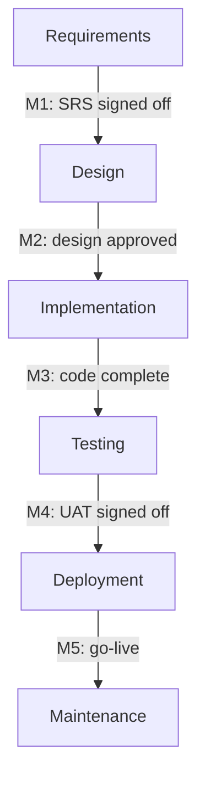

**Where the work items sit:** the plan is a set of [phases, milestones, and deliverables](work_items.md#phase-milestone-and-deliverable), broken into WBS tasks on a Gantt chart. Requirements produce the [BRD and SRS](sdlc_documents.md#analysis-documents). Design produces the [design doc and detailed design](sdlc_documents.md#design-documents). Testing produces the [test plan, test cases, test summary report, and UAT sign-off](sdlc_documents.md#testing-documents). Deployment runs the [rehearsal](sdlc_documents.md#rehearsal), the [go / no-go](sdlc_documents.md#go-no-go-meeting), and the [release checklist](sdlc_documents.md#release-checklist). Any change to signed-off requirements is a [scope change request](work_items.md#scope-change-request) against the baseline. Most [bugs](work_items.md#bug) surface in the Testing phase, which is late and expensive to fix.

---

### 2. V-Model - "For every step, define how you'll prove it worked"

> _"For every decision, define how you'll prove it worked."_

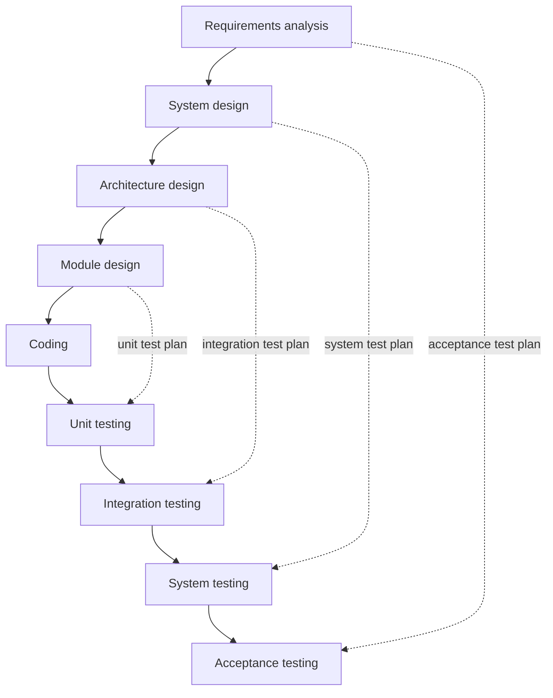

The left side goes down from requirements to code, and the right side climbs back up through testing. Each dotted line pairs a design level with the test level that verifies it. That test plan is written *at the same time* as the design, not after the code.

An evolution of Waterfall for high-stakes domains. At every stage of development, you define a corresponding test that will prove the work was done correctly. Requirements get acceptance tests. Architecture gets integration tests. Code gets unit tests. Nothing moves forward without a plan for verifying it — because in aviation or medical devices, "it seemed to work" isn't good enough.

**Use when:** Safety-critical systems where correctness must be formally proven at every level.

**Ref:** Barry Boehm; DO-178C (aviation) and IEC 62304 (medical software) standards


**Where the work items sit:** the same phases, milestones, and sign-offs as Waterfall. Each design document (SRS, system design, architecture, [detailed design](sdlc_documents.md#detailed-design)) comes with its own [test plan](sdlc_documents.md#test-plan). An [RTM](sdlc_documents.md#rtm) traces every requirement to the test that proves it. A bug found on the right side is traced back to the left-side level whose specification it breaks.

---

### 3. Scrum - "Build a little, show it, improve"

> _"Inspect and adapt."_ — Ken Schwaber & Jeff Sutherland

Scrum broke the long planning horizon into short, repeatable sprints of one to two weeks. At the end of each sprint, you have something real to show — working software, not a status report. A Product Owner decides what matters, a Scrum Master keeps the team unblocked, and the team owns how the work gets done. The retrospective at the end of each cycle asks the question most processes skip: how do we get better?

**Key roles:** Product Owner, Scrum Master, Developers

**Key ceremonies:** Sprint Planning, Daily Standup, Sprint Review, Retrospective

**Ref:** [_The Scrum Guide_](https://scrumguides.org/) — Ken Schwaber & Jeff Sutherland (free)

**Practical detail:** [Lifecycle → Agile, Scrum, Kanban](lifecycle.md#agile-scrum-kanban)


**How it works:**

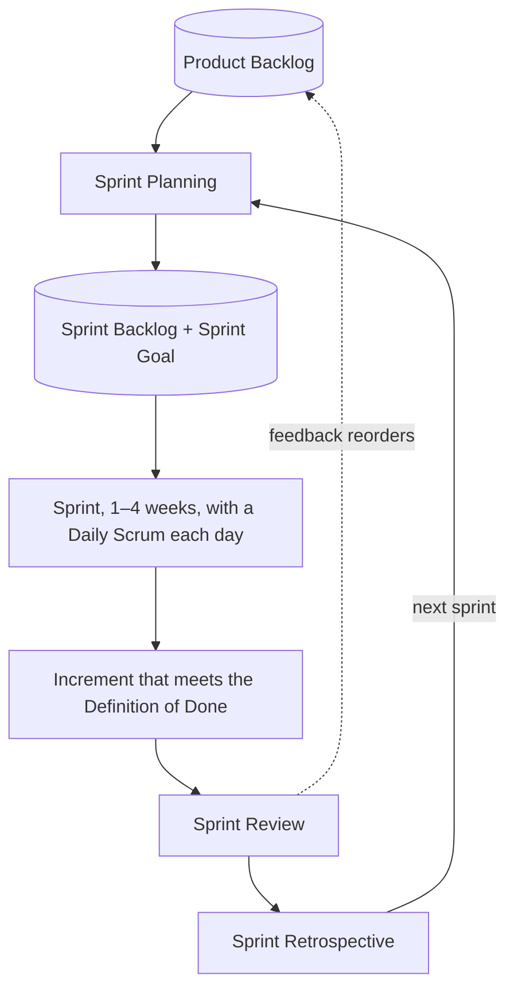

**Where the work items sit:** [epics, stories, bugs, spikes, and tech debt](work_items.md#how-work-items-fit-together) wait in the ordered [Product Backlog](work_items.md#backlog) and are refined until they meet the Definition of Ready. [Sprint Planning](work_items.md#sprint-planning) sets the Sprint Goal and breaks stories into [tasks](work_items.md#task-and-sub-task). Inside the sprint, each story runs a small SDLC of its own: design, code, [pull request](work_items.md#pull-request-merge-request) and review, test. The [Sprint Review](work_items.md#sprint-review) turns feedback into backlog changes, and the [Retrospective](work_items.md#sprint-retrospective) produces action items. A change of mind just reorders the backlog. A formal [change request](work_items.md#scope-change-request) is needed only when a contract fixes the scope.

---

### 4. Kanban - "Finish before you start something new"

> _"Stop starting, start finishing."_ — David Anderson

Where Scrum organizes work into time-boxed sprints, Kanban lets work flow continuously — like a kitchen that cooks orders as they arrive rather than batching them by the hour. The key insight is WIP limits: capping how much work is "in progress" at once forces the team to finish things before starting new ones, which surfaces bottlenecks that would otherwise stay hidden.

**Use when:** Support, maintenance, or workflows where new tasks arrive unpredictably.

**Ref:** David Anderson, [_Kanban: Successful Evolutionary Change_](https://www.amazon.com/Kanban-David-J-Anderson/dp/0984521402) (2010)

**Practical detail:** [Lifecycle → Agile, Scrum, Kanban](lifecycle.md#agile-scrum-kanban)


**How it works:** a board with one column per step and a WIP limit on each column. A card moves right only when the next column has room.

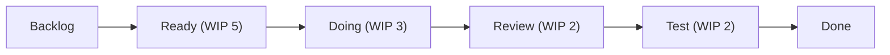

**Where the work items sit:** every card is a work item of any type: [story](work_items.md#user-story), [task](work_items.md#task-and-sub-task), [bug](work_items.md#bug), incident follow-up, or service request. The columns are the SDLC phases. Urgent work such as a [production incident](work_items.md#production-incident) uses an *expedite* swimlane that may break the WIP limit. There are no sprints. Instead there are regular meetings: a *replenishment* meeting refills Ready, and *delivery reviews* look at lead time, cycle time, and the cumulative flow diagram. Releases happen whenever work is done. **Scrumban** keeps Scrum's roles and retrospectives but replaces sprint commitments with a Kanban flow.

---

### 5. SAFe - "Scrum, but for 50 teams"

> _"Align, collaborate, deliver."_

When Agile teams multiply across a large organization, the question becomes: how do fifty teams stay pointed in the same direction? SAFe answers by adding coordination layers above individual Scrum teams — synchronizing them into Program Increments of roughly ten weeks, with shared planning events and portfolio-level alignment. It trades some of Agile's simplicity for the structure large enterprises need.

**Use when:** Many teams across an organization need to coordinate and ship together.

**Ref:** Dean Leffingwell, [Scaled Agile Framework](https://scaledagileframework.com/)


**How it works:**

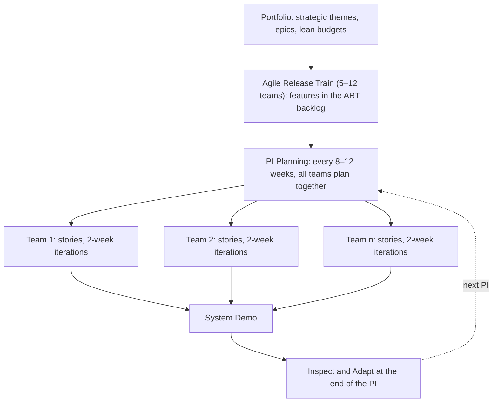

**Where the work items sit:** portfolio [epics](work_items.md#epic) are split into *features* (each fits in one PI), and features into [stories](work_items.md#user-story) (each fits in one iteration). PI Planning produces PI objectives and a board of cross-team dependencies. The PI boundaries act as milestones, while releases can happen on demand. SAFe 6.0 renamed the *Program Increment* to the [Planning Interval ↗](https://framework.scaledagile.com/planning-interval); both are abbreviated PI.

---

### 6. XP (Extreme Programming)

> _"If it's good practice, do it all the time."_ — Kent Beck

Kent Beck asked a simple question: if code review is good, what if you reviewed every line as it was written? If testing is good, what if you wrote the test before the code? XP takes the best-known engineering practices and applies them continuously rather than occasionally — pair programming, TDD, continuous integration, and small releases done constantly, not at the end of a long cycle.

**Use when:** Teams that want rigorous code quality and very fast feedback loops.

**Ref:** Kent Beck, [_Extreme Programming Explained_](https://www.amazon.com/Extreme-Programming-Explained-Embrace-Change/dp/0321278658) (1999)


**How it works:** nested feedback loops, from months down to minutes.

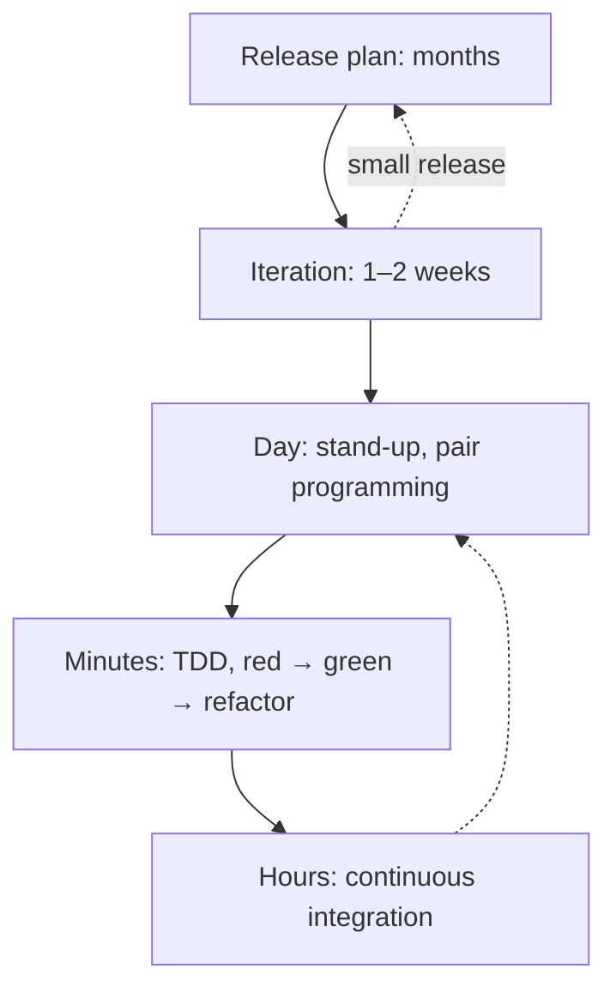

**Where the work items sit:** XP is where [user stories](work_items.md#user-story) (on index cards) and [spikes](work_items.md#spike) come from. The customer writes acceptance tests for each story. Developers split stories into tasks and estimate them, and the velocity of the last iteration ("yesterday's weather") sets how much fits in the next one.

---

### 7. Shape Up - "Decide how much time it's worth, not how long it takes"

> _"Appetite, not estimates."_ — Ryan Singer

Basecamp grew tired of backlogs that never shrank and estimates that never held. Shape Up inverts the usual approach: instead of estimating how long a feature will take, you decide upfront how much time you're willing to spend — the "appetite." Senior people shape the problem into something solvable within a fixed 6-week cycle, small teams own the solution completely, and anything that doesn't get bet on this cycle simply doesn't happen.

**Use when:** Small, autonomous product teams that want focused cycles without backlog debt.

**Ref:** Ryan Singer, [_Shape Up_](https://basecamp.com/shapeup) — Basecamp (free online book)


**How it works:**

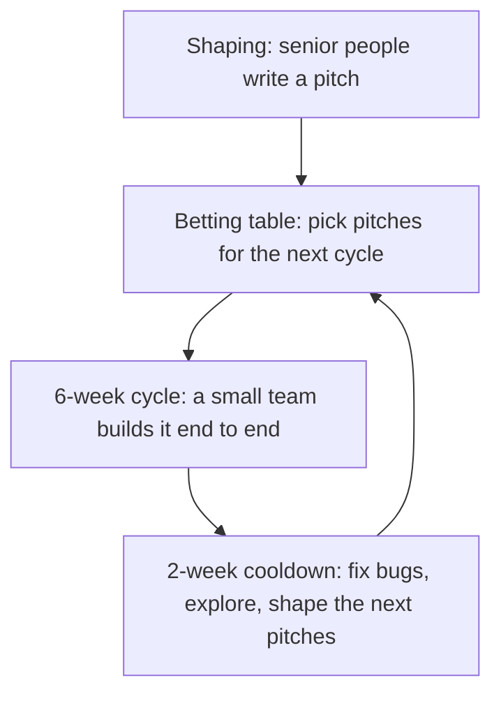

**Where the work items sit:** Shape Up has no backlog. A *pitch* replaces the epic and the story: it states the problem, the appetite, a rough solution, the rabbit holes, and the no-gos. The team splits the work into *scopes* instead of tasks and tracks progress on *hill charts*. A *circuit breaker* applies: work that isn't done in six weeks does not roll over automatically. It must be pitched again.

---

### 8. RUP - "Waterfall + iteration + formal governance"

> _"Structure the chaos of iterative development."_

RUP was IBM's answer to the rigidity of Waterfall and the looseness of early iterative methods. It gives large teams a formal framework of four phases — Inception, Elaboration, Construction, Transition — each with defined milestones, roles, and artifacts. You iterate within each phase, but the overall governance structure stays firm. The result is more adaptable than Waterfall and more auditable than Scrum.

**Use when:** Large enterprise or government projects requiring formal traceability and documented governance.

**Ref:** Philippe Kruchten, [_The Rational Unified Process_](https://www.amazon.com/Rational-Unified-Process-Introduction-3rd/dp/0321197704) (1998)


**How it works:** four phases, each ending in a milestone, with iterations inside every phase. All the disciplines (requirements, design, implementation, test, deployment) run in every phase, just with different intensity.

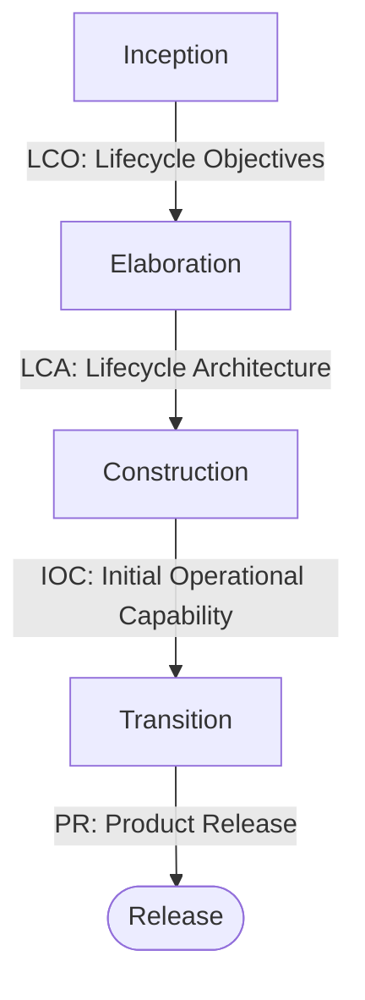

**Where the work items sit:** [phases and milestones](work_items.md#phase-milestone-and-deliverable) as in Waterfall, but each phase is planned as a series of iterations. The key artifacts are the vision document, the [use cases](sdlc_documents.md#use-case), the software architecture document, and an iteration plan per iteration.

---

### 9. Iterative & Incremental - "Build it in slices, improve it each pass"

> _"Deliver a working slice, learn, repeat."_

Instead of one long pass through the SDLC, the project is split into increments. Each increment goes through analysis, design, build, and test, and delivers a working slice of the system. Later increments add features (*incremental*) and improve what earlier ones built (*iterative*). It is older than Agile and is the common ancestor of Scrum, RUP, and Spiral.

**Use when:** Requirements are mostly known but too big to deliver in one go, or you want early feedback without adopting a full framework.

**Ref:** Craig Larman & Victor Basili, _Iterative and Incremental Development: A Brief History_ (IEEE Computer, 2003); [Wikipedia ↗](https://en.wikipedia.org/wiki/Iterative_and_incremental_development)

**How it works:**

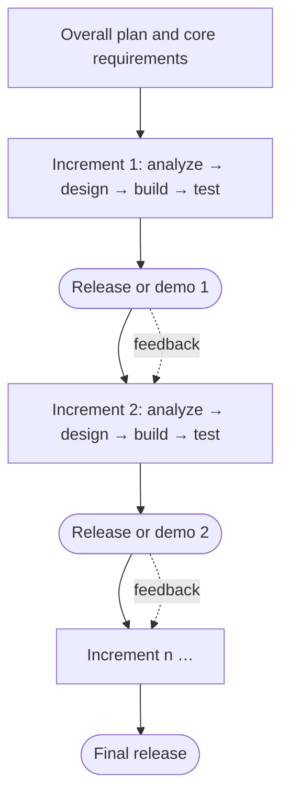

**Where the work items sit:** the release plan lists the increments as [milestones](work_items.md#phase-milestone-and-deliverable). Each increment has its own scope list (features or [stories](work_items.md#user-story)), its own test cycle, and its own [release notes](sdlc_documents.md#release-notes). Feedback changes the scope of the next increment instead of turning into a formal change request, unless the contract fixes scope.

---

### 10. Hybrid (Water-Scrum-Fall) - "Plan like waterfall, build like Scrum"

> _"Fixed milestones outside, sprints inside."_

Most real projects, outsourcing and fixed-price ones especially, are hybrid. The contract, budget, and milestones are planned up front, waterfall style. Development runs in Scrum sprints. Release goes back to waterfall, with formal SIT, UAT, sign-off, and go-live. Forrester analyst Dave West named this pattern *Water-Scrum-Fall* in 2011. It fits when the client needs a fixed date, price, or formal acceptance but the team still wants short feedback loops. The risk is that the up-front phase locks scope so tightly that each sprint becomes a mini-waterfall. Keep a working change-request process and an ordered backlog inside the fixed scope.

**Use when:** Contracts fix scope, price, or dates and need formal acceptance, but the team wants iterative delivery.

**Ref:** Dave West, _Water-Scrum-Fall Is the Reality of Agile for Most Organizations Today_ (Forrester, 2011)

**How it works:**

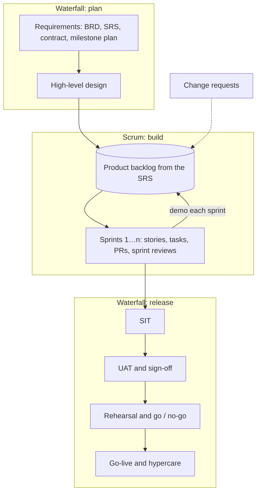

**Where the work items sit:** the outer plan is made of [phases, milestones, and deliverables](work_items.md#phase-milestone-and-deliverable), from M1 (SRS signed off) to M5 (go-live), often with payments attached. Changes to signed-off scope are [scope change requests](work_items.md#scope-change-request) against that baseline. Inside the build phase, the work is [epics, stories, tasks, and bugs](work_items.md#how-work-items-fit-together) in [sprints](work_items.md#sprint) with a Definition of Done. The release phase uses the [test plan, test summary report, UAT sign-off](sdlc_documents.md#testing-documents), [rehearsal](sdlc_documents.md#rehearsal), [go / no-go](sdlc_documents.md#go-no-go-meeting), and [release notes](sdlc_documents.md#release-notes). It ends with hypercare and a [handover](sdlc_documents.md#handover-document).

---

### 11. Spiral - "Spend the most effort where the risk is"

> _"Find the biggest risk, kill it, repeat."_ 

Barry Boehm's spiral model treats a project as a series of loops. Each loop starts by naming the biggest remaining risk and reducing it, often by building a prototype, before developing the next, more complete version. The loops grow in cost and completeness until the final one, which looks a lot like waterfall. It introduced the idea that *risk*, not a fixed sequence of phases, should drive the plan.

**Use when:** Large, novel, high-risk systems, where the main question is "can this even work?"

**Ref:** Barry Boehm, _A Spiral Model of Software Development and Enhancement_ (IEEE Computer, 1988); [Wikipedia ↗](https://en.wikipedia.org/wiki/Spiral_model)

**How it works:**

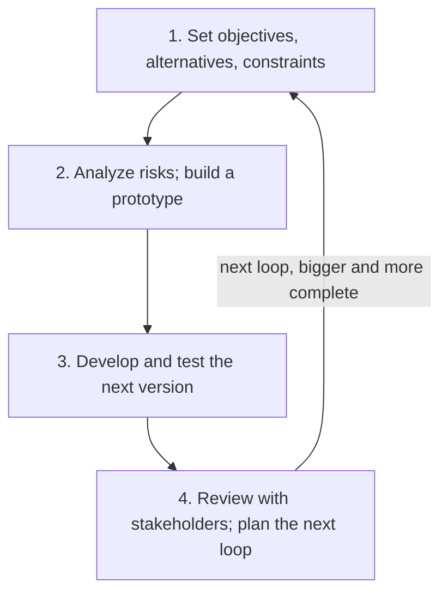

**Where the work items sit:** each loop ends at a review [milestone](work_items.md#phase-milestone-and-deliverable). The central artifact is the risk register (see [RAID log](work_items.md#other-item-types)), and [spikes](work_items.md#spike) and prototypes are the main tools for reducing risk.

---

### Comparing the Models

| Model | Planning | Delivery | Change is handled by | Best for |
|---|---|---|---|---|
| **Waterfall** | All up front | Once, at the end | A formal CR against the baseline | Stable, well-understood requirements |
| **V-Model** | All up front, with a test plan per level | Once, at the end | A formal CR, plus re-verification | Safety-critical systems |
| **Iterative & Incremental** | An overall plan, plus a plan per increment | Each increment | The next increment's scope | Large systems with mostly known requirements |
| **Spiral** | One loop at a time, driven by risk | Prototypes, then releases | The next loop | Large, novel, high-risk systems |
| **RUP** | Phases with milestones, iterations inside | End of Construction / Transition | Iteration plans | Large enterprise or government projects |
| **Scrum** | A product goal, plus one sprint at a time | Potentially every sprint | Reordering the backlog | Product teams with changing requirements |
| **Kanban** | Continuous replenishment | Continuously | Reordering the queue | Support, ops, maintenance, unpredictable inflow |
| **XP** | A release plan, plus iterations | Small, frequent releases | The next iteration | Teams that want strong engineering practices |
| **Shape Up** | One six-week bet at a time | Each cycle | The next betting table | Small, autonomous product teams |
| **SAFe** | Portfolio plus PI plans | Each PI, or on demand | PI planning | Many teams on one product line |
| **Hybrid** | Milestones up front, sprints inside | At milestones (UAT, go-live) | CRs for scope; backlog order inside it | Fixed-price and outsourcing projects |

---

### Same Work, Different Words

Each model names the same ideas differently. The items are defined, with templates, on [Work Items & Templates](work_items.md) and [SDLC Documents & Templates](sdlc_documents.md).

| Concept | Waterfall / V-Model | Scrum | Kanban | SAFe |
|---|---|---|---|---|
| **Unit of time** | Phase | Sprint | None (continuous flow) | PI, split into iterations |
| **Checkpoint** | Milestone, phase gate | Sprint Review | Delivery review | System Demo, Inspect & Adapt |
| **Big unit of work** | Deliverable, work package | Epic | Epic, or a large card | Epic → Feature |
| **Small unit of work** | WBS task | Story → task | Card | Story → task |
| **Requirements live in** | BRD / SRS | Product Backlog | The backlog column | ART and team backlogs |
| **Changing scope** | Change request against the baseline | Reorder the backlog | Reorder the backlog | Re-plan at PI planning |
| **Progress shown by** | Gantt chart, % complete | Burndown, velocity | Cumulative flow, cycle time | PI objectives, burn-up |
| **Owner of the plan** | Project Manager | Product Owner | The team / service delivery manager | Product Management, RTE |
| **"Done" means** | Deliverable signed off | Definition of Done met | Reached the Done column | DoD met, PI objectives achieved |
| **Looking back** | Lessons learned | Retrospective | Retrospective / operations review | Inspect & Adapt |

---

## Practices & Design Approaches

### TDD — Test-Driven Development

> _"Red, Green, Refactor."_ — Kent Beck

You write the test before you write the code — which means you define exactly what "done" looks like before you start. The test fails (red), you write just enough code to make it pass (green), then you clean it up without breaking it (refactor). The discipline forces small, focused steps and produces a safety net that makes future changes fearless.

**Ref:** Kent Beck, [_Test-Driven Development: By Example_](https://www.amazon.com/Test-Driven-Development-Kent-Beck/dp/0321146530) (2002)

**Practical detail:** [Lifecycle → TDD and BDD](lifecycle.md#tdd-and-bdd)

---

### BDD — Behavior-Driven Development

> _"Given... When... Then."_

BDD extends TDD by writing tests in plain English, so that a non-technical product manager can read a test suite and verify it describes the right behavior. The format — Given a context, When an action happens, Then something should be true — bridges the gap between what the business wants and what the code actually does.

```
Given: a user is logged in
When: they click "Delete Account"
Then: their account is removed and they receive a confirmation email
```

**Ref:** Dan North, [_Introducing BDD_](https://dannorth.net/introducing-bdd/) (2006); [Cucumber](https://cucumber.io/docs/bdd/)

**Practical detail:** [Lifecycle → TDD and BDD](lifecycle.md#tdd-and-bdd)

---

### DDD — Domain-Driven Design

> _"The heart of software is its ability to solve domain-related problems for its users."_ — Eric Evans

In a complex business, the hardest part of building software is understanding the domain — the real-world rules, relationships, and language of banking, healthcare, logistics, or whatever the business actually does. DDD says the code should speak that language directly. When a developer and a domain expert talk about an "Order," they should mean exactly the same thing, with no translation layer between them.

**Ref:** Eric Evans, [_Domain-Driven Design_](https://www.amazon.com/Domain-Driven-Design-Tackling-Complexity-Software/dp/0321125215) (2003)

**Further reading:** [The Architecture Bookshelf → Domain-Driven Design](../advanced/books.md#domain-driven-design)

---

## Glossary

| Term  | Full form                     | Plain meaning                                          |
| ----- | ----------------------------- | ------------------------------------------------------ |
| BDD   | Behavior-Driven Development   | Write tests as plain English user stories              |
| CI    | Continuous Integration        | Merge and test code many times per day                 |
| CoC   | Convention over Configuration | Sensible defaults reduce trivial decisions             |
| DDD   | Domain-Driven Design          | Model code around the real-world business domain       |
| DRY   | Don't Repeat Yourself         | One source of truth for every piece of knowledge       |
| KISS  | Keep It Simple, Stupid        | The simplest solution is usually the best              |
| PI    | Program Increment (Planning Interval since SAFe 6.0) | ~10-week synchronized cycle across Scrum teams (SAFe)  |
| RUP   | Rational Unified Process      | IBM's structured iterative development process         |
| SAFe  | Scaled Agile Framework        | Agile practices scaled for large organizations         |
| SoC   | Separation of Concerns        | Different responsibilities belong in different parts   |
| TDD   | Test-Driven Development       | Write tests before writing code                        |
| WIP   | Work In Progress              | Tasks currently being worked (Kanban limits this)      |
| XP    | Extreme Programming           | Agile methodology focused on rigorous coding practices |
| YAGNI | You Aren't Gonna Need It      | Build only what you need right now                     |

For the full list of software, SDLC, and operations terms across the handbook, see [Terms](terms.md).
