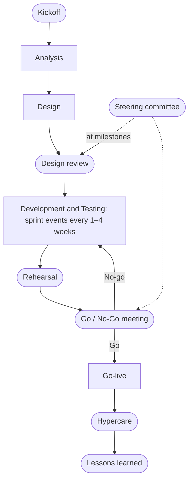

# SDLC Documents & Templates

[Work items](work_items.md) live in a tracker and close when the work is done. **Documents** are what a team writes to agree on what to build, design it, prove it works, ship it, and run it. This page lists the common ones by [SDLC phase](lifecycle.md#sdlc-phases) and gives a template for each.

Not every project needs every document. Agile product teams keep them short and next to the code. Outsourcing and fixed-price projects usually need the formal ones (BRD, SRS, test report, UAT sign-off) signed by the client, because those documents *are* the agreed baseline that [change requests](work_items.md#scope-change-request) are measured against.

## Documents by Phase

| Phase | Document | Answers | Usually written by |
|---|---|---|---|
| Analysis | [BRD / PRD](#brd-and-prd) | Why does the business need this, and what should the product do? | BA, PO / PM |
| Analysis | [SRS / FRS](#srs-and-frs) | Exactly what must the system do, and how well? | BA, with the tech lead |
| Analysis | [Use Case](#use-case) | How does a user reach a goal, step by step? | BA |
| Analysis | [Q&A Sheet](#qa-sheet) | What did the client clarify? | BA / BrSE |
| Analysis → Testing | [RTM](#rtm) | Is every requirement designed, built, and tested? | BA / QA |
| Design | [Design Doc / RFC](#design-doc-and-rfc) | How will we build it, and why this way? | Tech lead / architect |
| Design | [Detailed Design](#detailed-design) | Which modules, tables, and algorithms exactly? | Developers |
| Design | [ADR](#adr) | What did we decide, and why? | Whoever owns the decision |
| Design | [API Contract](#api-contract) | What does the interface look like? | API owner, with its consumers |
| Development | [README](#readme) | How do I run, test, and use this? | Developers |
| Development → Deployment | [Changelog](#changelog) | What changed in each version? | Developers, often generated |
| Testing | [Test Plan](#test-plan) | What will we test, how, and when are we done? | QA lead |
| Testing | [Test Case](#test-case) | What are the steps and expected result for one check? | QA |
| Testing | [Test Summary Report](#test-summary-report) | What did testing find? Is it ready to ship? | QA lead |
| Testing | [UAT Sign-off](#uat-sign-off) | Does the business accept it? | Client / business owner |
| Deployment | [Release Checklist](#release-checklist) | Are we ready to go live, and can we roll back? | Release manager / tech lead |
| Deployment | [Release Notes](#release-notes) | What do users need to know about this version? | PM / tech writer |
| Maintenance | [Runbook](#runbook) | How do I handle this known situation? | The team that runs the service |
| Maintenance | [Handover Document](#handover-document) | What does the new owner need to know? | The outgoing team |

Incident reports and postmortems are covered with the other operational items on [Work Items → Production Incident](work_items.md#production-incident) and [Work Items → Postmortem](work_items.md#postmortem). Project events and their documents (kickoff, meeting minutes, rehearsal, go / no-go, lessons learned) are in [Meetings and Events](#meetings-and-events).

## Analysis Documents

Analysis turns a business need into requirements that people can design, build, and test against.

### BRD and PRD

A **BRD (Business Requirements Document)** states the business problem, the objectives, who is involved, what is in and out of scope, and the high-level requirements. It contains no technical design. It is typical in enterprise and outsourcing projects, where the client approves it.

A **PRD (Product Requirements Document)** is the product-company version. It covers the target users, the problems, the features, the success metrics, and the release criteria for a product or feature. Many teams write only one of the two.

**Template: BRD**

```markdown
# Business Requirements Document: <Project>

Version: 1.0 · Date: <yyyy-mm-dd> · Author: <BA> · Approvers: <business owner, sponsor>

## 1. Background and problem
<What is happening today, and why it is a problem for the business.>

## 2. Business objectives
- BO-1: Reduce checkout abandonment from 68% to 55% by <date>

## 3. Stakeholders
| Name / role | Interest | Involvement |
|---|---|---|
| ... | ... | Approver / consulted / informed |

## 4. Scope
In scope:
- ...
Out of scope:
- ...

## 5. Business requirements
| ID | Requirement | Priority (MoSCoW) | Source |
|---|---|---|---|
| BR-01 | Returning customers must not re-enter their shipping address | Must | Customer survey <date> |

## 6. Business rules
- ...

## 7. Assumptions and constraints
- ...

## 8. Success criteria / KPIs
- ...

## 9. Risks
- ...

## 10. Approval
| Name | Role | Signature | Date |
|---|---|---|---|
```

**Template: PRD**

```markdown
# PRD: <Feature or product>

Owner: <PM> · Status: Draft / In review / Approved · Target release: <...>

## Problem
<Who has the problem, how often, how we know (data, research).>

## Target users / personas
- ...

## Goals and success metrics
- <Metric>: from <baseline> to <target>

## Non-goals
- ...

## User stories / use cases
- As a ..., I want ..., so that ...

## Requirements
| ID | Requirement | Priority | Notes |
|---|---|---|---|

## UX / design
<Links to flows and mockups.>

## Release criteria
<Functional, performance, accessibility, legal / compliance gates.>

## Open questions
- ...
```

### SRS and FRS

An **SRS (Software Requirements Specification)** is the detailed, testable description of what the system must do. It holds the **functional requirements** (FR: *what* it does) and the **non-functional requirements** (NFR: *how well*: performance, security, availability, usability). An **FRS (Functional Requirements Specification)** covers only the functional part. The classic structure comes from IEEE 830, which has been replaced by ISO/IEC/IEEE 29148 ([Wikipedia: SRS ↗](https://en.wikipedia.org/wiki/Software_requirements_specification)).

Give every requirement an ID so that design, code, and tests can point to it (see [RTM](#rtm)). Write each one so it can be tested: "p95 < 1.5 s" can be tested, "the page is fast" cannot.

**Template: SRS**

```markdown
# Software Requirements Specification: <System>

Version: <n> · Status: Draft / Approved · Based on: BRD v<n>

## 1. Introduction
1.1 Purpose · 1.2 Scope · 1.3 Definitions and abbreviations · 1.4 References

## 2. Overall description
2.1 Users and roles · 2.2 Operating environment · 2.3 Constraints · 2.4 Assumptions and dependencies

## 3. Functional requirements
### FR-012 Save shipping address
- Description: The system shall let a logged-in customer save up to 5 shipping addresses.
- Priority: Must
- Source: BR-01
- Inputs / outputs: <fields, formats>
- Business rules: Postcode is validated against the selected country's format.
- Acceptance: AC-012-1 … AC-012-3

## 4. Non-functional requirements
| ID | Category | Requirement | Measure |
|---|---|---|---|
| NFR-01 | Performance | Checkout page loads quickly on mobile | p95 < 1.5 s on 4G |
| NFR-02 | Availability | Checkout is available | 99.9% per month |
| NFR-03 | Security | Addresses are encrypted at rest | AES-256 |
| NFR-04 | Accessibility | Checkout is usable with a screen reader | WCAG 2.1 AA |

## 5. External interfaces
User interfaces · APIs · other systems · hardware

## 6. Data requirements
<Entities, retention, privacy classification.>

## Change history
| Version | Date | Change | Author |
|---|---|---|---|
```

### Use Case

A **use case** describes how an *actor* (a user or another system) reaches one goal through a sequence of interactions with the system. It includes what happens when things go wrong. Use cases suit complex flows better than one-line user stories, and their alternative flows become test cases. The structure below follows Alistair Cockburn's *Writing Effective Use Cases*.

**Template: Use case**

```markdown
# UC-07: Check out with a saved address

Primary actor: Returning customer · Level: User goal
Preconditions: Customer is logged in; cart is not empty
Trigger: Customer clicks "Checkout"

## Main success scenario
1. System shows the shipping step, pre-filled with the default saved address.
2. Customer confirms the address.
3. System shows the payment step.
4. Customer pays.
5. System confirms the order and sends an email.

## Extensions (alternative and error flows)
1a. Customer has no saved address: system shows an empty form with a "Save this address" option.
2a. Customer picks another saved address: system updates shipping costs and continues at step 3.
4a. Payment is declined: system shows the reason and stays on the payment step.

## Postconditions
Success: order is created and paid. Failure: no order is created; cart is unchanged.

Related: FR-012, STORY-101
```

### Q&A Sheet

A **Q&A sheet** is a shared log of questions to the client and their answers. It is how requirements get clarified on offshore projects, where the BrSE or BA collects the questions from the team. Every answer that changes a requirement should update the BRD or SRS. If the answer adds scope, it should become a [change request](work_items.md#scope-change-request).

**Template: Q&A sheet**

```markdown
| No | Date | Ref (doc / section) | Question | Proposed answer / assumption | Asked by | Answer | Answered by | Date | Status |
|---|---|---|---|---|---|---|---|---|---|
| 14 | 2026-10-02 | SRS FR-012 | Is the 5-address limit per account or per country? | Per account | Dev team | Per account | Client PO | 2026-10-03 | Closed |
```

Always include a *proposed answer*. It speeds up the reply, and if the client never answers, it documents the assumption the team worked from.

### RTM

An **RTM (Requirements Traceability Matrix)** links each requirement forward to its design, code, and tests, and back to its business source. It answers "is anything unbuilt or untested?" before release, and "what does this change affect?" when a CR arrives.

**Template: RTM**

```markdown
| Req ID | Requirement | Source | Design ref | Story / task | Test cases | Status |
|---|---|---|---|---|---|---|
| FR-012 | Save up to 5 shipping addresses | BR-01 | DD §4.2 | STORY-101 | TC-CHK-014, TC-CHK-015 | Passed |
| NFR-01 | Checkout p95 < 1.5 s on 4G | BR-03 | HLD §6 | TASK-220 | PT-003 | Not run |
```

## Design Documents

Design turns requirements into a plan for building them, and records the decisions so later readers know *why*.

### Design Doc and RFC

A **design doc** (also *technical design*, *HLD (High-Level Design)*, or *Basic Design* on Japanese-style projects) explains how a system or change will be built. It covers the main components, how data flows between them, and the trade-offs. An **RFC (Request for Comments)** is the same kind of document, circulated widely for feedback before a decision. Write one when a change is hard to reverse, touches several teams, or takes more than a few weeks. See [Design Docs at Google ↗](https://www.industrialempathy.com/posts/design-docs-at-google/) for how one large company uses them.

The *Alternatives considered* section matters most. It shows reviewers the options you rejected and why.

**Template: Design doc / RFC**

```markdown
# Design: <Title>

Author: <name> · Reviewers: <names> · Status: Draft / In review / Approved / Implemented
Last updated: <date> · Related: <PRD, epic, ADRs>

## Context and problem
<What exists today and why it isn't enough. Link the requirements.>

## Goals
- ...

## Non-goals
- ...

## Proposal
<Architecture diagram, main components, data flow, APIs, data model.>

## Alternatives considered
| Option | Pros | Cons | Why not |
|---|---|---|---|

## Cross-cutting concerns
Security · privacy · observability · scalability · cost · accessibility

## Risks and open questions
- ...

## Rollout and migration
<Feature flags, phased rollout, data migration, rollback.>

## Testing plan
- ...
```

### Detailed Design

A **detailed design** (also *LLD (Low-Level Design)* or *DD*) goes one level down from the design doc. It covers module structure, class and function responsibilities, database tables, sequence diagrams for the main flows, validation rules, and error handling. Formal projects deliver it as a document. Agile teams usually keep the same information as code, schemas, and short notes in the repo.

**Template: Detailed design (per module)**

```markdown
# Detailed Design: <Module>

Version: <n> · Based on: <design doc / HLD section>

## 1. Responsibilities
<What this module does and doesn't do.>

## 2. Structure
<Packages / classes / functions and how they depend on each other.>

## 3. Data model
| Table | Column | Type | Null | Key | Description |
|---|---|---|---|---|---|
| addresses | id | uuid | N | PK | |
| addresses | customer_id | uuid | N | FK → customers.id, index | |
| addresses | postcode | varchar(16) | N | | Validated per country |

## 4. Main flows
<Sequence diagram per flow: who calls whom, in what order.>

## 5. Interfaces
<Function signatures or endpoints, inputs, outputs, errors.>

## 6. Validation and error handling
| Case | Behavior | Error code / message |
|---|---|---|

## 7. Logging, metrics, and security notes
- ...
```

### ADR

An **ADR (Architecture Decision Record)** is a short note of *one* significant decision: its context, the decision itself, and what follows from it. Write one whenever a decision is expensive to reverse, affects other teams, or is something a newcomer will ask "why?" about.

- **Where:** in the repo, one file per decision, numbered: `docs/adr/0007-use-postgres-full-text-search.md`.
- **Lifecycle:** `Proposed → Accepted`, later `Deprecated` or `Superseded by ADR-00xx`. Once accepted, an ADR is not edited. When the decision changes, write a new ADR that supersedes the old one, so the history stays readable.
- **Formats:** the original by [Michael Nygard ↗](https://cognitect.com/blog/2011/11/15/documenting-architecture-decisions) (below), or [MADR ↗](https://adr.github.io/madr/), which adds *considered options* with pros and cons. More templates and tools are at [adr.github.io ↗](https://adr.github.io/).

Design docs propose. ADRs record what was decided. A design doc often ends in one or more ADRs. For why writing decisions down matters, see [Becoming Senior → Communication](becoming_senior.md#communication-is-part-of-the-system).

**Template: ADR**

```markdown
# ADR-0007: Use PostgreSQL full-text search for product search

Status: Proposed / Accepted / Deprecated / Superseded by ADR-00xx
Date: 2026-11-04 · Deciders: <names>

## Context
<The forces at play: requirements, constraints, what the spike found.
 e.g. 5M products, p95 < 200 ms required, team has no OpenSearch experience.>

## Decision
<What we will do, in full sentences: "We will use PostgreSQL full-text search
 with a GIN index on products, and revisit if the catalog passes 20M rows.">

## Consequences
<What becomes easier, what becomes harder, what we must now watch.>
```

### API Contract

An **API contract** is the agreed description of an interface: its endpoints, request and response shapes, errors, and auth. It is written *before* or alongside the code, so frontend, backend, and partner teams can work in parallel and contract tests can check that both sides keep it. For REST this is usually an [OpenAPI ↗](https://spec.openapis.org/oas/latest.html) file in the repo. For design rules on status codes, versioning, and pagination, see [APIs](apis.md).

**Template: OpenAPI stub**

```yaml
openapi: 3.1.0
info:
  title: Orders API
  version: 1.4.0
paths:
  /orders/{orderId}:
    get:
      summary: Get one order
      parameters:
        - name: orderId
          in: path
          required: true
          schema: { type: string }
      responses:
        "200":
          description: The order
          content:
            application/json:
              schema: { $ref: "#/components/schemas/Order" }
        "404":
          description: Order not found
components:
  schemas:
    Order:
      type: object
      required: [id, status, totalMinor, currency]
      properties:
        id: { type: string }
        status: { type: string, enum: [pending, paid, shipped, cancelled] }
        totalMinor: { type: integer, description: "Amount in minor units, e.g. cents" }
        currency: { type: string, example: "USD" }
```

## Development Documents

These live next to the code and change with it.

### README

The **README** is the front door of a repository. Someone new should be able to go from clone to a running app and passing tests using only the README. Anything longer than that (architecture, ADRs, runbooks) gets a link, not a copy.

**Template: README**

````markdown
# <Project name>

<One sentence: what this is and who it's for.>

## Quick start
```bash
git clone <repo> && cd <repo>
cp .env.example .env          # fill in the values marked TODO
make setup                    # install dependencies
make run                      # http://localhost:8000
```

## Running tests
```bash
make test
```

## Configuration
| Variable | Required | Default | Description |
|---|---|---|---|

## Deployment
<How it gets to staging and production, or a link to the pipeline.>

## Architecture
<One paragraph and a link to the design doc / ADRs in `docs/`.>

## Contributing
<Branching model, commit convention, how to open a PR.>

## Owners
<Team, chat channel, on-call rotation.>
````

### Changelog

A **changelog** is a file in the repo, `CHANGELOG.md`, that lists every notable change per version for developers, integrators, and operators. The [Keep a Changelog ↗](https://keepachangelog.com/en/1.1.0/) convention puts the newest version on top. It keeps an `[Unreleased]` section that fills up as work merges and becomes the next version at release time. It groups entries under fixed headings: *Added, Changed, Deprecated, Removed, Fixed, Security*. Pair it with [Semantic Versioning](lifecycle.md#semantic-versioning) so the version number says whether anything breaks.

If the team uses [Conventional Commits](lifecycle.md#conventional-commits), tools such as [release-please ↗](https://github.com/googleapis/release-please), [semantic-release ↗](https://github.com/semantic-release/semantic-release), or [git-cliff ↗](https://git-cliff.org/) can generate the changelog and the next version number from the commit history.

**Changelog vs release notes**

| | Changelog | Release notes |
|---|---|---|
| **Audience** | Developers, integrators, operators | Users, customers, support, sales |
| **Lives in** | `CHANGELOG.md` in the repo | Product site, app store, docs, email |
| **Content** | Every notable change, grouped by type | Curated highlights in plain, benefit-first language |
| **Written** | Continuously under `[Unreleased]`, or generated from commits | At release time, using the changelog as input |

**Template: CHANGELOG.md**

```markdown
# Changelog

All notable changes to this project are documented in this file.
The format is based on [Keep a Changelog](https://keepachangelog.com/en/1.1.0/),
and this project adheres to [Semantic Versioning](https://semver.org/spec/v2.0.0.html).

## [Unreleased]
### Added
- Pay with a saved card (#117)

## [2.15.0] - 2026-11-04
### Added
- Save shipping address at checkout (#101)
### Changed
- Coupon codes are now case-insensitive (#477)
### Deprecated
- `GET /v1/addresses`; use `/v2/addresses`. Removal planned for 3.0.0
### Fixed
- Checkout returned 500 for lowercase coupon codes (#482)
### Security
- Upgrade `<library>` to fix CVE-YYYY-NNNNN

[Unreleased]: https://github.com/<org>/<repo>/compare/v2.15.0...HEAD
[2.15.0]: https://github.com/<org>/<repo>/compare/v2.14.3...v2.15.0
```

## Testing Documents

Testing documents say what will be checked, record what was checked, and give the go / no-go evidence. The test types themselves are in [Lifecycle → Testing](lifecycle.md#testing).

### Test Plan

A **test plan** sets the strategy for a release or project: the scope, test levels and types, environments, entry and exit criteria, schedule, and risks. The classic standard is IEEE 829, now replaced by ISO/IEC/IEEE 29119-3 ([Wikipedia: ISO/IEC 29119 ↗](https://en.wikipedia.org/wiki/ISO/IEC_29119)). **Exit criteria** are the most important part. They decide in advance what "done testing" means, so the decision isn't made under deadline pressure.

**Template: Test plan**

```markdown
# Test Plan: <Project / release>

Version: <n> · Author: <QA lead> · Approvers: <PM, tech lead, client>

## 1. Scope
In scope: <features, requirement IDs> · Out of scope: <...>

## 2. Test levels and types
Unit (dev) · Integration · System / E2E · Regression · Performance · Security · UAT

## 3. Approach
<Manual vs automated, tools, risk-based priorities, regression strategy.>

## 4. Environments and test data
<Which environment, which build, how data is created and reset. No real PII.>

## 5. Entry criteria
- Build deployed to the test environment; smoke test passes
- Test cases reviewed and approved

## 6. Exit criteria
- 100% of planned cases executed; ≥ 95% passed
- No open S1 / S2 defects; S3 defects have an agreed plan

## 7. Schedule
| Activity | Start | End | Owner |
|---|---|---|---|

## 8. Roles and responsibilities
- ...

## 9. Risks and mitigations
- ...

## 10. Deliverables
Test cases · defect reports · test summary report
```

### Test Case

A **test case** is one check: preconditions, steps, test data, and the expected result. It is written from a requirement or acceptance criterion and linked back to it in the [RTM](#rtm). Steps should be specific enough that someone else gets the same result. Automated tests are test cases too: the test name and assertions play the role of the title and the expected result.

**Template: Test case**

```markdown
| Field | Value |
|---|---|
| ID | TC-CHK-014 |
| Title | Saved address is pre-filled at checkout |
| Requirement / story | FR-012 / STORY-101 |
| Priority | High |
| Type | Functional · Regression |
| Preconditions | Logged-in customer with one saved address |
| Test data | Account `qa_user_07` |
| Steps | 1. Add any item to the cart. 2. Click "Checkout". |
| Expected result | The shipping form shows the saved address |
| Actual result | |
| Status | Not run / Passed / Failed / Blocked |
| Defect | (bug ID if failed) |
```

### Test Summary Report

A **test summary report** (also *test report* or *test completion report*) closes a test cycle. It covers what was tested, the results, open defects, risks, and a go / no-go recommendation. It is the evidence for the release decision and, on client projects, for acceptance.

**Template: Test summary report**

```markdown
# Test Summary Report: <Release / sprint>

Build: <version> · Environment: <staging> · Period: <dates> · Author: <QA lead>

## Summary
<One paragraph: ready to release? Under what conditions?>

## Execution
| Planned | Executed | Passed | Failed | Blocked |
|---|---|---|---|---|
| 240 | 236 | 228 | 5 | 3 |

## Defects
| Severity | Found | Fixed | Open |
|---|---|---|---|
| S1 | 1 | 1 | 0 |
| S2 | 6 | 6 | 0 |
| S3 | 14 | 11 | 3 |

## Open defects accepted for release
| ID | Severity | Summary | Workaround / plan |
|---|---|---|---|

## Not tested, and why
- ...

## Risks
- ...

## Recommendation
Go / Go with conditions / No-go
```

### UAT Sign-off

**UAT (User Acceptance Testing)** is when the business or client checks the system against their own scenarios. The **sign-off** is their written acceptance. On contract projects it often triggers go-live and the payment milestone, so it should name the version tested and any defects accepted as known issues.

**Template: UAT sign-off**

```markdown
# UAT Sign-off: <Project> <version>

UAT period: <dates> · Environment: <UAT / staging> · Build: <version>

## Scope tested
<Business scenarios / requirement IDs covered.>

## Results
<Scenarios passed / failed; link to the test summary report.>

## Known issues accepted for go-live
| ID | Summary | Agreed fix date |
|---|---|---|

## Decision
[ ] Accepted   [ ] Accepted with conditions: <...>   [ ] Rejected: <reason>

| Name | Role | Signature | Date |
|---|---|---|---|
```

## Deployment Documents

### Release Checklist

A **release checklist** (or *go-live checklist*) makes launches repeatable. It lists what must be true before, during, and after the deploy, ending in an explicit **go / no-go** decision. Each production deploy may also need a [production change request](work_items.md#production-change-request).

**Template: Release checklist**

```markdown
# Release checklist: v2.15.0 — <date>

## Before
- [ ] Scope frozen; release candidate built and tagged `v2.15.0-rc.1`
- [ ] Regression suite passed on staging; test summary report says Go
- [ ] UAT signed off (if required)
- [ ] DB migrations rehearsed on a production-size copy and backward compatible
- [ ] Backup taken; restore tested
- [ ] Rollback plan written and rehearsed
- [ ] Feature flags set to their launch values
- [ ] Changelog and release notes ready
- [ ] Production change request approved (if required)
- [ ] On-call and support briefed; status page message drafted
- [ ] Go / no-go meeting held: <decision, who decided>

## During
- [ ] Deploy (canary / blue-green / rolling)
- [ ] Smoke tests pass in production
- [ ] Error rate, latency, and business metrics normal on the dashboards

## After
- [ ] Tag `v2.15.0` on main; publish release notes
- [ ] Close or move released tickets
- [ ] Watch metrics for <n> hours
- [ ] Announce to stakeholders
```

### Release Notes

**Release notes** tell users what changed in a version and whether they need to do anything. They are curated from the [changelog](#changelog) and written for the reader. Write "You can now save your shipping address", not "Added AddressService". Put anything that needs action, such as breaking changes or deprecations, where nobody can miss it.

**Template: Release notes**

```markdown
# Release 2.15 — November 4, 2026

## Highlights
**Saved addresses at checkout.** Returning customers can save their shipping
address and skip retyping it next time. <screenshot>

## Improvements
- Coupon codes now work regardless of upper or lower case.

## Fixes
- Fixed an error at checkout when a coupon code was typed in lowercase.

## Action required
- API users: `GET /v1/addresses` is deprecated and will be removed in 3.0.
  Move to `/v2/addresses` by <date>.

## Known issues
- ...

Full technical changelog: <link>
```

## Maintenance Documents

### Runbook

A **runbook** is a step-by-step guide for a known operational situation, usually linked from the alert that fires for it. Someone who has never seen the service should be able to follow it at 3 a.m. How to write and keep runbooks for a server is covered in [Running a Server → Runbooks](../tool_tip/server_operations.md#11-runbooks). The template below is the per-alert shape.

**Template: Runbook**

```markdown
# Runbook: <Alert or situation: "Orders API p95 latency > 1 s">

Service: orders-api · Owner: <team> · Last tested: <date>

## When this fires
<Alert name, threshold, dashboard link.>

## Impact
<What users experience; the usual severity.>

## Diagnose
1. Check <dashboard>: is it every endpoint or one?
2. `kubectl -n orders top pods`: is CPU or memory saturated?
3. Check the database: <dashboard / query> for slow queries or lock waits.

## Mitigate
- Recent deploy? Roll back: <command or pipeline link>
- CPU-bound? Scale out: `kubectl -n orders scale deploy/orders-api --replicas=<n>`
- Lock waits? <steps>

## Verify
<What "recovered" looks like on the dashboard.>

## Escalate
<Who and when: "Not recovered in 30 min → page the DB on-call (<rotation>)".>
```

### Handover Document

A **handover document** transfers ownership of a system: to another team, to the client's operations team at the end of a project, or to the next person when someone leaves. It points to everything else (README, design docs, ADRs, runbooks) and adds what only the outgoing team knows. That includes quirks, open issues, and recurring manual tasks.

**Template: Handover document**

```markdown
# Handover: <System> — from <team A> to <team B>

Date: <date> · Handover period: <dates, with shadowing sessions>

## 1. System overview
<What it does, who uses it, how critical it is (SLA / SLO).>

## 2. Where everything is
Repos · design docs · ADRs · runbooks · dashboards · CI/CD · tracker board

## 3. Environments and access
| Environment | URL | How to get access | Secrets stored in |
|---|---|---|---|

## 4. How to deploy and roll back
<Link to the pipeline and the release checklist.>

## 5. Recurring tasks
| Task | Frequency | How |
|---|---|---|
| Rotate TLS certificates | 90 days | <runbook link> |

## 6. Known issues, tech debt, and quirks
- ...

## 7. Open work
<Tickets in progress and their state.>

## 8. Contacts
<Previous owners, vendors, client contacts, escalation.>

## Sign-off
<Receiving team confirms they can deploy, operate, and debug the system.>
```

## Meetings and Events

Some events happen at fixed points of a project, and each one has a document that comes out of it. The sprint events (planning, daily scrum, review, retrospective) are on [Work Items → Sprint](work_items.md#sprint). This section covers the project-level ones.



| Event | When in the SDLC | What comes out of it |
|---|---|---|
| **Kickoff** | Start of the project or of a big phase | Shared goals, scope, roles, plan, and ways of working, recorded in the minutes |
| **Design review** | End of Design | An approved design doc and ADRs, or a list of changes needed |
| **Steering committee** | Monthly, or at each milestone | Decisions on scope, budget, schedule, and escalated risks |
| **Rehearsal** | Before go-live, a data migration, or a failover | A timed, corrected runbook and a proven rollback |
| **Go / No-Go meeting** | Just before a release | A recorded go or no-go decision, with who made it and why |
| **Hypercare** | The first 1–4 weeks after go-live | Fast fixes from the project team, then handover to normal support |
| **Lessons learned** | End of a phase or project | What to repeat and what to change on the next project |

### Kickoff

A **kickoff** starts a project or a major phase. Its job is to make sure everyone, client and team alike, leaves with the same picture of the goal, the scope, who does what, and how the team will work. Send the deck and minutes afterwards. Most scope arguments later in a project trace back to something nobody said at the kickoff.

**Template: Kickoff agenda**

```markdown
# Kickoff: <Project> — <date>

1. Why this project: business goal and success criteria (PO / sponsor)
2. Scope: in, out, and the main assumptions
3. Plan: phases, milestones, release dates (or sprint cadence)
4. Team and roles: RACI, who decides what, contacts
5. Ways of working: tools (tracker, repo, chat), meetings, Definition of Done,
   how change requests work, escalation path
6. Risks and dependencies known today
7. Next steps and owners
8. Questions
```

### Meeting Minutes

**Meeting minutes** (*MoM*, minutes of meeting) record what a meeting decided and who will do what by when. Most readers only read the decisions and the action items, so put those first. Send the minutes within a day and ask attendees to reply with any corrections. Once agreed, the minutes are the record if someone later disputes a decision.

**Template: Meeting minutes**

```markdown
# Minutes: <Meeting name> — <date>

Attendees: <names / roles> · Absent: <...> · Note-taker: <name>

## Decisions
1. <Decision> — decided by <name / group>

## Action items
| Action | Owner | Due |
|---|---|---|
| ... | ... | ... |

## Discussion notes
- <Agenda item>: <key points, options discussed>

## Open questions
- <Question> — owner to follow up: <name>

Next meeting: <date>
```

### Rehearsal

A **rehearsal** (or *dress rehearsal*) is a full practice run of a risky operation in a production-like environment, usually staging. The team follows the real runbook and times every step, including the rollback, before doing it for real. Every problem the rehearsal finds is one that won't happen on go-live night. The [staging environment](lifecycle.md#environments) exists partly for this.

| Kind | What you practice |
|---|---|
| **Deployment rehearsal** | The full release procedure from the [release checklist](#release-checklist): deploy, migrate, smoke test, roll back |
| **Cutover rehearsal** | Moving from an old system to a new one: freeze, migrate data, verify, switch traffic. Measure the total time against the allowed downtime window |
| **Rollback rehearsal** | Undoing the release, including the data. A rollback plan that has never run is a guess |
| **DR drill / game day** | Failing over to a backup region or restoring from backup on purpose, to prove recovery meets the RTO and RPO |

Rehearse until a run completes cleanly and inside the time window. Then freeze the runbook and use exactly that version on the day.

**Template: Rehearsal plan and report**

```markdown
# Rehearsal: <operation> — run #<n> — <date>

Environment: <staging, with production-size data> · Runbook version: <link / commit>
Participants: <names and roles, same people as go-live> · Time window allowed: <e.g. 4 h>

## Steps
| # | Step | Owner | Planned | Actual | Result | Notes |
|---|---|---|---|---|---|---|
| 1 | Announce freeze; stop writes | Ops | 0:00–0:10 | 0:00–0:12 | OK | |
| 2 | Backup production DB | DBA | 0:10–0:40 | 0:12–0:55 | Slow | Snapshot took 43 min, tune |
| 3 | Run migrations | Dev | 0:40–1:30 | ... | ... | |
| 4 | Smoke tests | QA | ... | ... | ... | |
| 5 | Rollback test | Ops | ... | ... | ... | |

## Total time
Planned <h:mm> · Actual <h:mm> · Within window? yes / no

## Issues found
| Issue | Fix | Owner | Fixed before next run? |
|---|---|---|---|

## Decision
Ready for go-live / Needs another rehearsal
```

### Go / No-Go Meeting

The **go / no-go meeting** is the last checkpoint before a release or go-live. The owners of each area say *go* or *no-go* against criteria agreed in advance. If any criterion is not met, the default is no-go, unless the business owner explicitly accepts the risk and that acceptance is written down.

**Template: Go / No-Go**

```markdown
# Go / No-Go: <release> — <date, time>

| Area | Criterion | Owner | Status |
|---|---|---|---|
| Quality | Test summary report: Go; no open S1/S2 | QA lead | Go / No-go |
| Business | UAT signed off | Client PO | Go / No-go |
| Operations | Rehearsal passed within the window; rollback proven | Ops lead | Go / No-go |
| Support | Support briefed; hypercare rota staffed | Support lead | Go / No-go |
| Change | Production change request approved | Change manager | Go / No-go |
| Communication | Users and stakeholders notified | PM | Go / No-go |

Decision: GO / NO-GO · Decided by: <name> · Accepted risks: <list, or none>
If no-go: next decision point <date>
```

### Lessons Learned

**Lessons learned** (or a *project retrospective*) is the [retrospective](work_items.md#sprint-retrospective) held at the end of a phase or a whole project. It looks back further than a sprint retro and writes the results down for the *next* project, not only for this team. Make it blameless, and store the result where the next project's kickoff will actually read it.

**Template: Lessons learned**

```markdown
# Lessons learned: <Project / phase> — <date>

Facilitator: <name> · Participants: <team, client, stakeholders>

## Outcome vs plan
| | Planned | Actual |
|---|---|---|
| Scope | | |
| Schedule | | |
| Effort / cost | | |
| Quality (defects after go-live) | | |

## What went well (keep doing)
- ...

## What went wrong (and why)
- ...

## Recommendations for the next project
| Recommendation | Area (estimation, requirements, testing, …) | Owner |
|---|---|---|
```

## Where Documents Live

- **Next to the code** (*docs as code*): README, changelog, ADRs, API contracts, runbooks, and design docs in Markdown in the repo. They are reviewed in PRs, versioned with the code, and published as a site, like this handbook.
- **In the wiki** (Confluence, Notion, Google Docs): documents that non-developers write or approve, such as the BRD, PRD, Q&A sheet, test reports, and sign-offs. Link them from the epic or the README.
- **In the tracker:** work items and their templates. See [Work Items → Where Templates Live](work_items.md#where-templates-live).

Whatever the location, each document needs an owner, a status (*Draft / Approved / Superseded*), and a date, so readers can tell whether it is still true.
