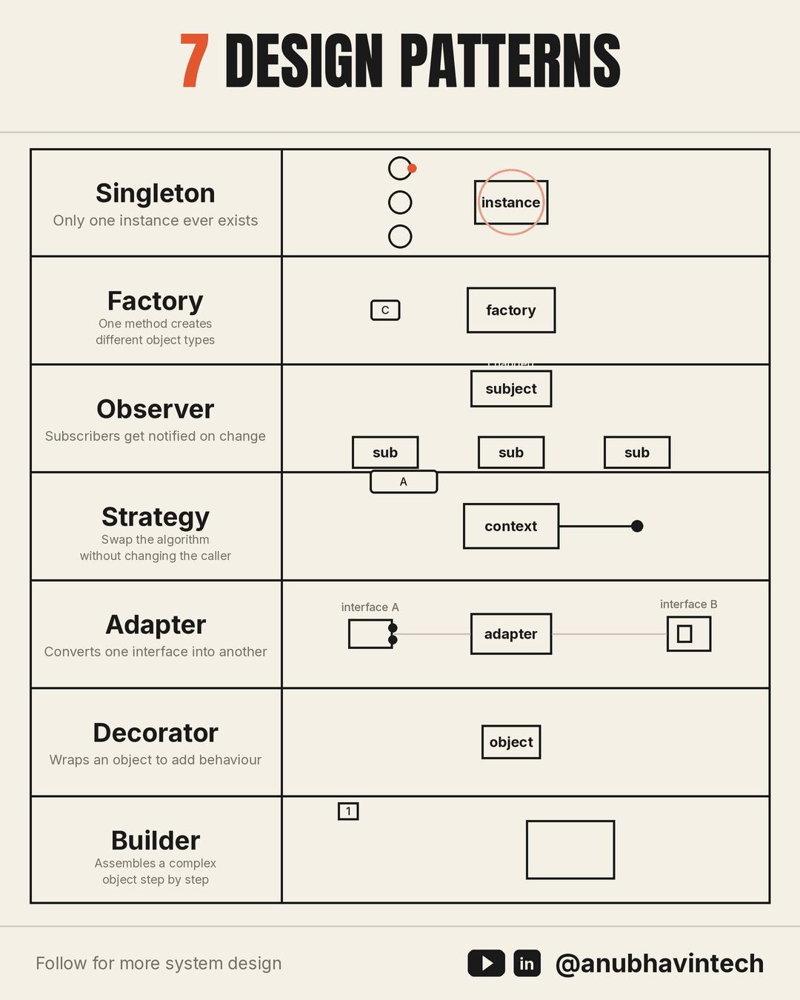
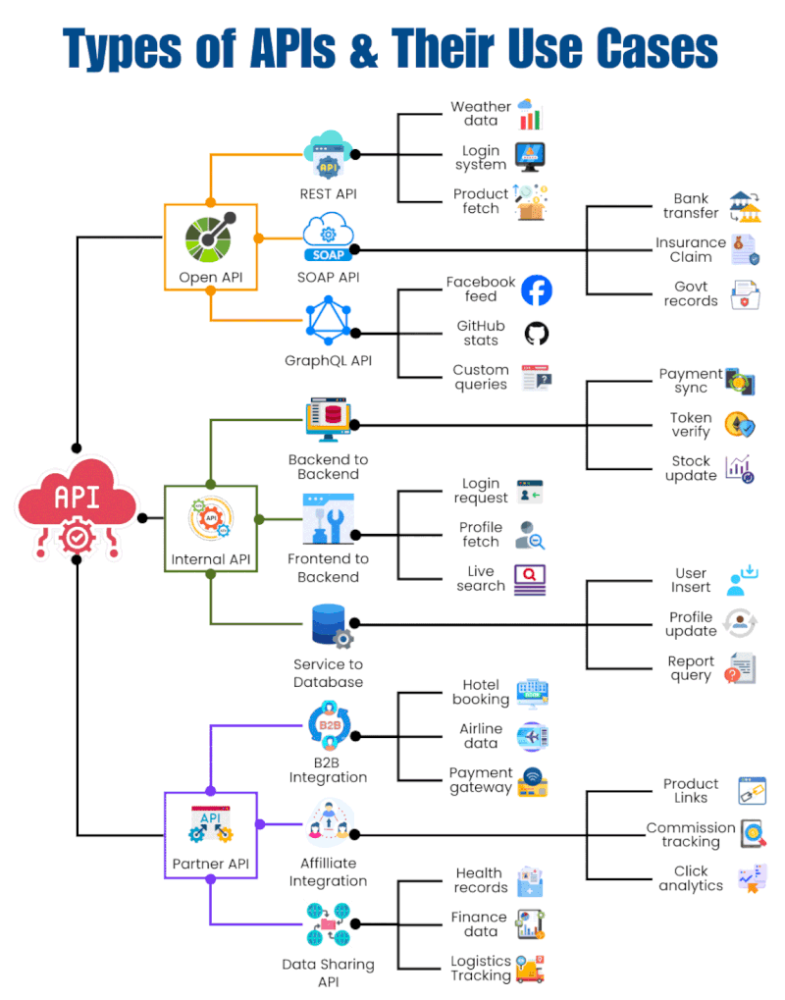
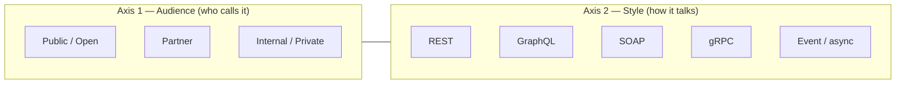
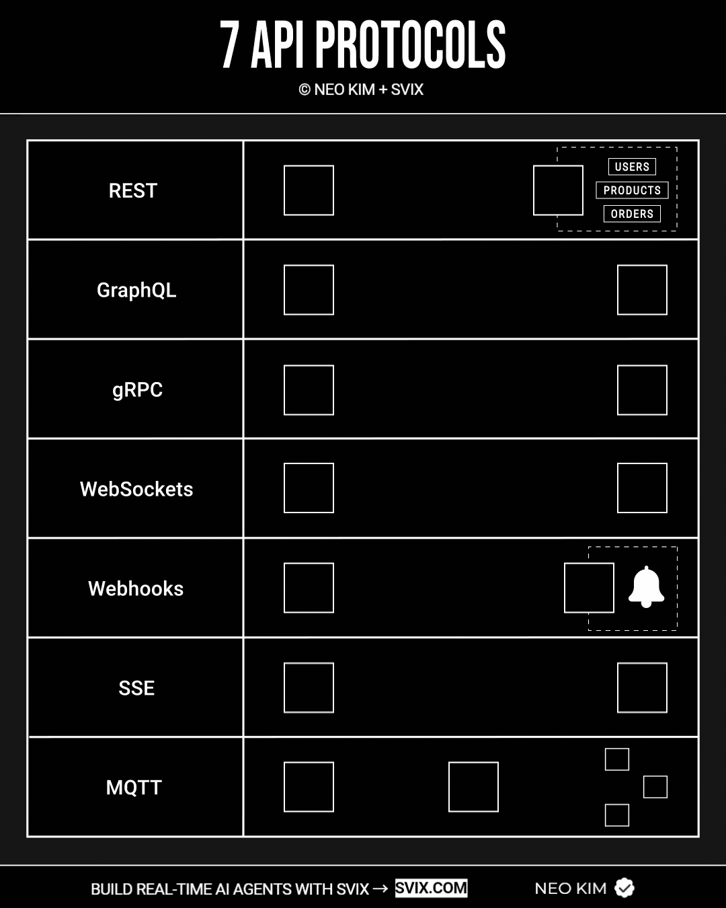
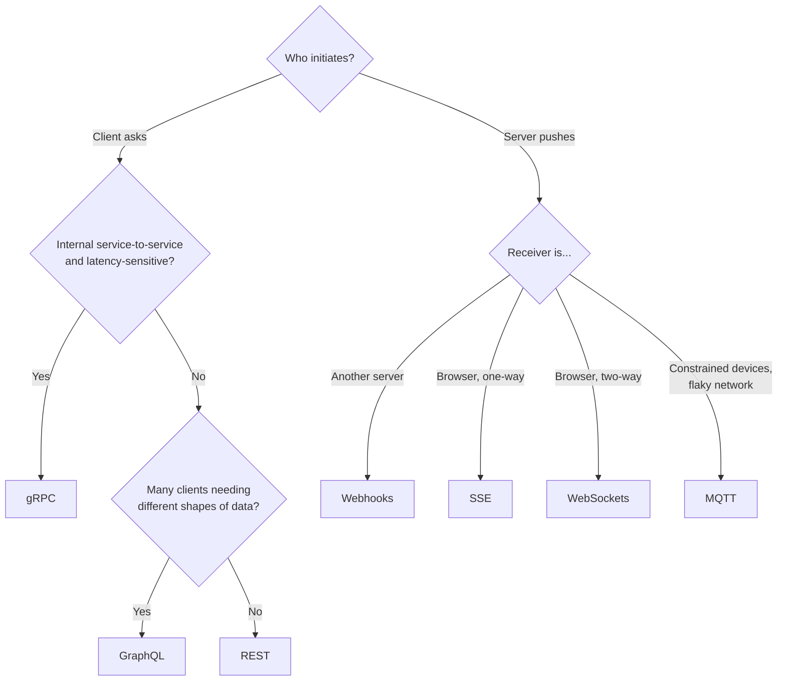
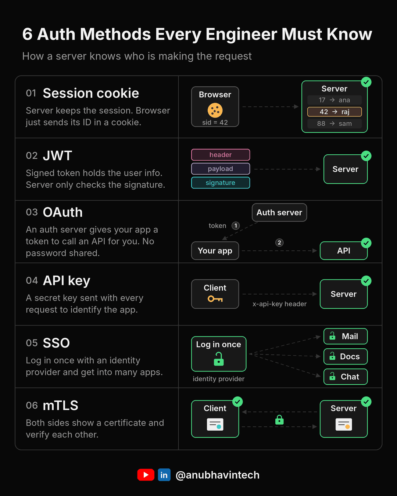
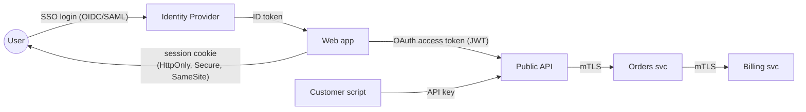
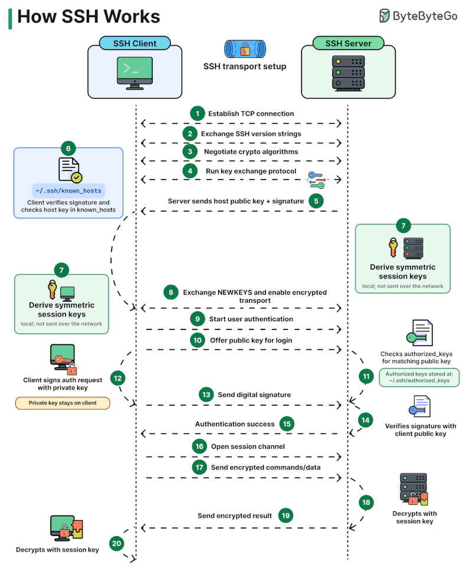
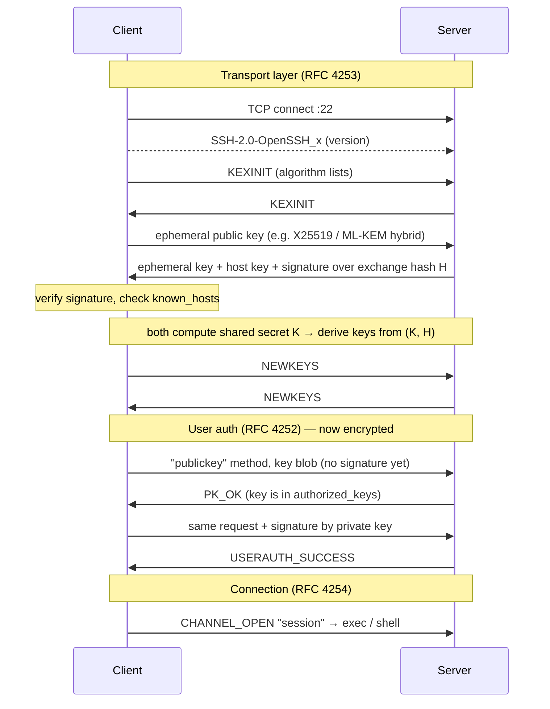
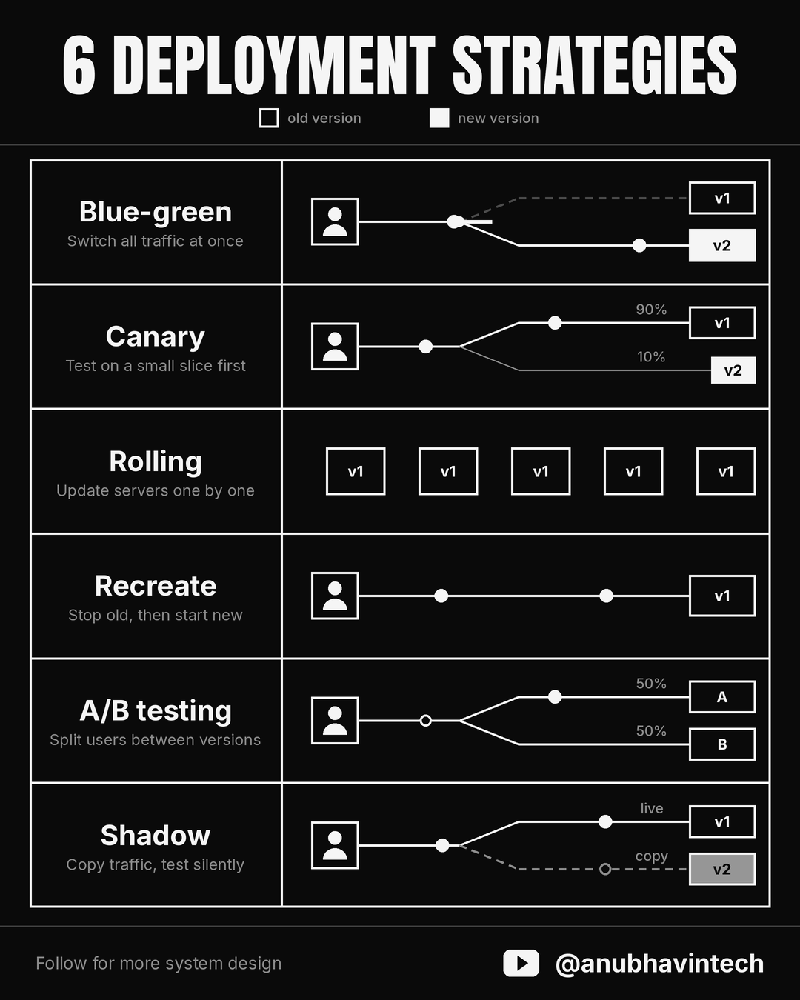

# System Design Notes

Six short LinkedIn posts on system design topics. They cover design patterns, API types, API protocols, authentication, how SSH works, and deployment strategies. Each section below starts with the original post (cited and credited), then adds detail, trade-offs, and primary sources the post didn't have room for.

For the building blocks these notes sit on, see [Architecture](architecture.md), [APIs](apis.md), [Security](security.md), and [Networking](networking.md).

!!! note "About the images"
    The infographics are copied from the original posts and remain the work of their authors. Each one is credited in its caption and linked back to the post. All posts were read on 2026-10-15.

| # | Topic | Post author | Posted |
|---|---|---|---|
| 1 | [Design Patterns](#1-seven-design-patterns) | Anubhav Sethi | 2026-10-04 |
| 2 | [Types of APIs](#2-types-of-apis) | Ritik Jain | 2026-10-11 |
| 3 | [API Protocols](#3-seven-api-protocols) | Neo Kim | 2026-09-24 |
| 4 | [Auth Methods](#4-six-auth-methods) | Anubhav Sethi | 2026-10-09 |
| 5 | [How SSH Works](#5-how-ssh-works) | Alex Xu (ByteByteGo) | 2026-10-01 |
| 6 | [Deployment Strategies](#6-six-deployment-strategies) | Anubhav Sethi | 2026-09-26 |

---

## 1. Seven Design Patterns

!!! quote "Source"
    Anubhav Sethi, *"7 design patterns that every engineer must know"*, LinkedIn, 2026-10-04. <https://www.linkedin.com/posts/anubhavintech_systemdesign-designpatterns-softwareengineering-activity-7512460719934697472-f1qM>



*Image: © Anubhav Sethi ([@anubhavintech](https://www.linkedin.com/in/anubhavintech)), from the post above.*

### What the post says

> Most bad code isn't wrong. It's just hard to change six months later. Design patterns exist to fix that second problem.

| Pattern | One-liner (from the post) | Typical use |
|---|---|---|
| **Singleton** | Only one instance ever exists, however many times it's requested | Shared config, connection pool. "Overused everywhere else." |
| **Factory** | One method creates different object types depending on what you ask for | Keeps the "which class do I create?" logic in one place |
| **Observer** | Subscribers are notified automatically when something they care about changes | Event systems, pub/sub |
| **Strategy** | Swap the algorithm without touching the code that calls it | Several ways to do one job: sorting, pricing rules |
| **Adapter** | Converts one interface into another so incompatible pieces work together | Wrapping a third-party library |
| **Decorator** | Wraps an object to add behaviour without changing the object | Middleware, logging wrappers |
| **Builder** | Assembles a complex object step by step | Avoiding a 12-argument constructor with many optional fields |

**Interview tip from the post:** in a low-level design (LLD) round, explaining *why* a pattern fits the problem matters more than naming it.

### Going deeper

All seven come from the "Gang of Four" (GoF) catalogue[^gof]. GoF sorts its 23 patterns into three families, which tells you what problem each one solves:

| Family | Problem it solves | Patterns here |
|---|---|---|
| **Creational** | *How* objects get made | Singleton, Factory Method, Builder |
| **Structural** | How objects are *composed* | Adapter, Decorator |
| **Behavioral** | How objects *communicate* and divide work | Observer, Strategy |

Points the post leaves out:

- **"Factory" is several patterns.** GoF has *Factory Method* (a subclass decides which class to create) and *Abstract Factory* (creates a whole family of related objects). The post describes the everyday **simple factory**, a function with a `switch`/`dict` lookup. That one is not in GoF, but it is the most common form in practice.
- **Singleton is mostly a warning.** It is global mutable state, it hides dependencies, and it makes tests share state. The modern habit is to build *one* instance at the composition root and pass it in with dependency injection. You still get a single instance, without the global access. See [Design Principles](principles.md) (Dependency Inversion).
- **Strategy and Decorator are composition over inheritance.** Both swap or stack behaviour at runtime instead of growing a class tree. This is GoF's own central advice: *"Favor object composition over class inheritance."*[^gof]
- **Adapter and Decorator look alike but differ in intent.** An Adapter *changes* the interface to match one the caller expects. A Decorator *keeps* the interface and adds behaviour. A *Proxy* keeps the interface and controls access.
- **Observer at system scale is pub/sub.** In-process Observer calls subscribers directly and synchronously. Across services, the same idea becomes a message broker (Kafka, RabbitMQ, MQTT, see [§3](#3-seven-api-protocols)) that decouples the publisher in time and in failure. One common bug: forgetting to unsubscribe, so the subject keeps dead listeners alive (a memory leak).
- **Many languages have the pattern built in.** Python decorators (`@functools.cache`), first-class functions as strategies, `dataclasses` with defaults instead of a Builder, a module as a natural singleton. Peter Norvig showed back in 1996 that 16 of the 23 GoF patterns are "invisible or simpler" in dynamic languages[^norvig].

??? example "Minimal Python sketches"

    ```python
    # Strategy: the algorithm is just a parameter
    def checkout(cart, pricing):            # pricing: Callable[[Cart], float]
        return pricing(cart)

    regular   = lambda c: c.total
    black_fri = lambda c: c.total * 0.7
    checkout(cart, black_fri)

    # Simple factory: one place decides which class
    PARSERS = {"json": JsonParser, "csv": CsvParser}
    def make_parser(kind: str):
        return PARSERS[kind]()

    # Adapter: make a 3rd-party client look like *our* interface
    class StripeGateway:                    # implements our PaymentGateway
        def __init__(self, client): self._c = client
        def charge(self, cents, token):
            return self._c.PaymentIntent.create(amount=cents, payment_method=token)

    # Decorator: same interface, extra behaviour
    def logged(fn):
        def wrapper(*a, **kw):
            log.info("call %s", fn.__name__)
            return fn(*a, **kw)
        return wrapper

    # Observer
    class Subject:
        def __init__(self): self._subs = []
        def subscribe(self, fn): self._subs.append(fn)
        def notify(self, event):
            for fn in self._subs: fn(event)

    # Builder (fluent)
    req = (RequestBuilder("GET", "/users")
           .header("Accept", "application/json")
           .timeout(5)
           .build())
    ```

**When *not* to use a pattern:** when no change is expected yet. Applying a pattern ahead of need is a classic YAGNI violation (see [Design Principles](principles.md)). Refactor *towards* a pattern once the second or third variant actually shows up[^kerievsky].

---

## 2. Types of APIs

!!! quote "Source"
    Ritik Jain, *"REST, GraphQL, SOAP… choosing an API isn't just about knowing the names"*, LinkedIn, 2026-10-11. <https://www.linkedin.com/posts/rjritikjain_apis-backenddevelopment-softwareengineering-activity-7514878700392280064-0r3T>



*Image: © Ritik Jain, from the post above.*

### What the post says

| API | Example uses (from the visual) |
|---|---|
| **REST** | Weather data, login systems, product fetch |
| **SOAP** | Bank transfers, insurance claims, government records: enterprise settings where strict contracts matter |
| **GraphQL** | Social feeds, GitHub stats, custom queries: clients choose exactly the fields they need |
| **Internal** | Backend↔backend (payment sync, token verify), frontend↔backend (login, live search), service↔database |
| **Partner** | B2B integration (hotel booking, airline data, payment gateways), affiliate integration (commission tracking) |
| **Data-sharing** | Health records, finance data, logistics tracking |

The post's key point:

> These categories aren't all mutually exclusive. REST, SOAP, and GraphQL describe API **approaches**, while internal, partner, and data-sharing APIs describe **how or where** APIs are used.

Questions to ask when designing one: *Who consumes it? What data is exchanged? How do authentication and security work? What performance, reliability, and compatibility requirements apply?*

### Going deeper

The point about mutual exclusivity is the most useful part of the post. Treat an API as **two independent choices**:



A Stripe payment API is *public + REST*. A Netflix internal call is *internal + gRPC*. A bank-to-regulator feed may be *partner + SOAP*. "Data-sharing" is really a partner or public API whose *payload* is the product.

**Audience changes the non-functional requirements more than the style does:**

| | Public | Partner | Internal |
|---|---|---|---|
| **Auth** | API keys, OAuth 2.0 for user data | OAuth client credentials, mTLS, signed requests | mTLS or service mesh identity, short-lived tokens |
| **Versioning** | Strict; you can't see your callers | Contractual, negotiated deprecation windows | Can move faster; consumers are known (consumer-driven contract tests) |
| **Rate limiting** | Mandatory, per key | Per partner, often per SLA tier | Protective, against cascading failure |
| **Docs** | Public portal, OpenAPI, SDKs | Private portal, onboarding | OpenAPI / `.proto` in the repo |
| **Typical style** | REST (cacheable, universal) | REST or SOAP (legacy, regulated) | gRPC, events, REST |

**On SOAP specifically.** It is an XML envelope protocol (W3C SOAP 1.2[^soap]) with a machine-readable contract (WSDL) and a family of WS-\* standards (WS-Security for message-level signing and encryption, WS-ReliableMessaging). Those standards are why it survives in banking, insurance, and government, even though almost no new public APIs choose it.

**On GraphQL.** It fixes over-fetching and under-fetching for varied clients. The cost moves to the server: HTTP caching gets harder (one `POST /graphql` endpoint), you need query depth and cost limits to stop expensive queries, and per-field resolvers can cause the *N+1* query problem, which tools like DataLoader batch away[^graphql].

The style comparison table and the contract rules (status codes, idempotency, versioning, pagination) are in [APIs](apis.md).

---

## 3. Seven API Protocols

!!! quote "Source"
    Neo Kim, *"If you want to go GOD-level with API design, learn these 7 protocols"*, LinkedIn, 2026-09-24. <https://www.linkedin.com/posts/nk-systemdesign-one_if-you-want-to-go-god-level-with-api-design-activity-7508871465753034753--hym>

    *Disclosure in the original:* the post and graphic are co-branded with and sponsored by **Svix**, a webhook-infrastructure vendor.



*Image: © Neo Kim + Svix, from the post above (animated).*

### What the post says

| Protocol | Mechanism | Use cases |
|---|---|---|
| **REST** | Resources + standard HTTP methods, stateless | CRUD APIs for web and mobile |
| **GraphQL** | Client requests exactly the data it needs | Apps with complex or changing data requirements |
| **WebSockets** | Bidirectional connection kept open | Chat, multiplayer games, real-time updates |
| **gRPC** | Remote calls via strongly typed contracts | Fast internal microservice communication |
| **Webhooks** | Event notifications pushed from one system to another | Event-driven workflows, real-time AI agents |
| **MQTT** | Lightweight publish/subscribe messages | IoT, unreliable or low-bandwidth networks |
| **SSE** | Server streams updates to the client over HTTP | Live feeds, notifications, AI response streaming |

### Going deeper

The seven differ mainly in **who starts the conversation** and **whether the connection stays open**:

| Protocol | Transport | Direction | Connection | Payload | Spec |
|---|---|---|---|---|---|
| **REST** | HTTP/1.1, 2, 3 | client → server (request/response) | short-lived | usually JSON | Fielding, 2000[^rest] |
| **GraphQL** | usually HTTP `POST` | client → server (+ subscriptions) | short-lived (subscriptions use WS/SSE) | JSON | GraphQL spec[^graphql] |
| **gRPC** | HTTP/2 | unary, server-stream, client-stream, bidi | long-lived, multiplexed | Protocol Buffers (binary) | grpc.io[^grpc] |
| **WebSockets** | TCP, upgraded from HTTP | full-duplex | long-lived | text or binary frames | RFC 6455[^ws] |
| **SSE** | HTTP | server → client only | long-lived | UTF-8 text events | WHATWG HTML[^sse] |
| **Webhooks** | HTTP `POST` | server → *another server* | one request per event | usually JSON | Standard Webhooks[^webhooks] |
| **MQTT** | TCP (or WebSocket) | pub/sub via a **broker** | long-lived | binary, tiny header | OASIS MQTT 5.0[^mqtt] |

**Choosing between them:**



Practical notes on each:

- **gRPC in browsers.** Browsers can't speak raw gRPC (they don't expose HTTP/2 trailers), so you need gRPC-Web plus a proxy, or Connect. This is why gRPC usually stays *internal*.
- **WebSockets need more operations work than they first appear to.** Connections are stateful, so load balancers need sticky sessions or a shared pub/sub backplane (Redis) to fan messages out across nodes. You also own heartbeats, reconnects, and back-pressure.
- **SSE is often enough.** If the client only *listens* (notifications, dashboards, LLM token streaming), SSE is plain HTTP. It passes through proxies, and the browser's `EventSource` reconnects automatically, resuming from the `Last-Event-ID` header. On HTTP/1.1 browsers limit each origin to about 6 connections, which HTTP/2 removes.
- **Webhooks: the hard parts are what Svix sells.** The receiver must verify an **HMAC signature** (do not trust the source IP) and reject old timestamps to stop replays. It should respond `2xx` *fast* and process asynchronously, and it should be **idempotent**, because senders retry and deliver at least once. The [Standard Webhooks](https://www.standardwebhooks.com/) spec codifies these headers.
- **MQTT QoS levels:** `0` at most once (fire and forget), `1` at least once (may duplicate), `2` exactly once (four-step handshake, most expensive). *Retained messages* give a new subscriber the last known value, and *Last Will* announces a device that disconnected uncleanly[^mqtt].
- **Webhooks vs. polling.** Polling every *N* seconds adds up to *N* seconds of latency and wastes most requests. Webhooks deliver immediately, but the receiver must be reachable and must handle duplicates. Many systems use both: webhooks for speed, plus a periodic reconcile poll so missed events still get picked up.

---

## 4. Six Auth Methods

!!! quote "Source"
    Anubhav Sethi, *"6 Auth Methods Every Engineer Should Know"*, LinkedIn, 2026-10-09. <https://www.linkedin.com/posts/anubhavintech_systemdesign-softwareengineering-authentication-share-7514229617755369472-wjLf>



*Image: © Anubhav Sethi ([@anubhavintech](https://www.linkedin.com/in/anubhavintech)), from the post above.*

### What the post says

| # | Method | How it works | Good for |
|---|---|---|---|
| 1 | **Session cookie** | Server stores the session; the browser holds only an ID in a cookie | Classic web apps |
| 2 | **JWT** | Signed token carries user info; server checks the signature, no DB lookup | Stateless APIs. *You can't easily revoke one before it expires.* |
| 3 | **OAuth** | Auth server gives an app a token to call an API on your behalf; no password shared | "Sign in with Google", third-party access |
| 4 | **API key** | One secret sent with every request; identifies the **app**, not the user | Server-to-server, public APIs |
| 5 | **SSO** | Log in once with an identity provider, get into many apps | Companies with many internal tools |
| 6 | **mTLS** | Client and server both present certificates and verify each other | Service-to-service traffic |

The post's summary:

> Sessions and JWT answer **"who is this user?"**
> OAuth answers **"what is this app allowed to do for the user?"**
> API keys and mTLS answer **"which app or service is this?"**

### Going deeper

**These are not six alternatives. They sit at different layers**, and real systems stack them. A typical SaaS uses SSO (OIDC) to log the user in, a session cookie to keep them logged in, OAuth access tokens (often JWTs) for its API, API keys for customer scripts, and mTLS between its own microservices.



| Method | Where state lives | Revocation | Main pitfall | Spec / guidance |
|---|---|---|---|---|
| **Session cookie** | Server (DB/Redis) | Instant: delete the row | CSRF, session fixation | OWASP Session Mgmt[^owasp-sess] |
| **JWT** | In the token | Hard: wait for expiry or keep a denylist | `alg: none` / algorithm confusion, long expiries, storing in `localStorage` (XSS) | RFC 7519[^jwt], OWASP JWT[^owasp-jwt] |
| **OAuth 2.0** | Auth server | Revoke grant / refresh token | Using it *as* login without OIDC; implicit flow | RFC 6749[^oauth], PKCE RFC 7636[^pkce] |
| **API key** | Server lookup | Rotate the key | Leaked in git, URLs, or client apps; no user context | — |
| **SSO** | Identity provider | Disable the user at the IdP | IdP becomes a single point of failure | OIDC[^oidc], SAML 2.0 |
| **mTLS** | Certificates (PKI) | Short-lived certs, CRL/OCSP | Certificate rotation and CA operations | RFC 8446 (TLS 1.3)[^tls], RFC 8705[^oauth-mtls] |

Corrections and additions to the post:

- **OAuth is *authorization*, not authentication.** "Sign in with Google" is really **OpenID Connect (OIDC)**, a thin identity layer on OAuth 2.0 that adds an *ID token* saying *who* logged in[^oidc]. Plain OAuth only says what an app *may do*. For browser and mobile apps use the **authorization code flow with PKCE**[^pkce]. The implicit flow is deprecated in OAuth 2.1.
- **Common JWT practice:** short-lived access token (5–15 min) plus a long-lived, *revocable* refresh token stored server-side. This keeps most of the "stateless" benefit and bounds the revocation problem the post mentions.
- **Session cookies are not obsolete.** For a browser-only app on one domain, a server-side session with `HttpOnly; Secure; SameSite=Lax` cookies is often *safer* than a JWT in JavaScript-reachable storage.
- **API keys:** send them in a header, never in the query string (URLs end up in logs). Scope them, rate-limit them per key, store only a hash, and make rotation easy.
- **mTLS in practice** is usually automated by a service mesh (Istio, Linkerd) or SPIFFE/SPIRE workload identities, so applications never handle certificates.
- **Missing from the list:** *passkeys / WebAuthn* (phishing-resistant public-key login, the direction user authentication is heading), and *HTTP Basic*, which is fine only over TLS for internal tooling.

AuthN vs. AuthZ, 401 vs. 403, and the OAuth sequence diagram are in [Security](security.md).

---

## 5. How SSH Works

!!! quote "Source"
    Alex Xu (ByteByteGo), *"How SSH Works"*, LinkedIn, 2026-10-01. <https://www.linkedin.com/posts/alexxubyte_systemdesign-coding-interviewtips-share-7511431696815169537-EaNa>



*Image: © ByteByteGo, from the post above (animated).*

### What the post says

Secure Shell gives secure access to a remote machine over an unsecured network:

1. The client opens a **TCP connection** to the SSH server.
2. Both sides **exchange version strings**, **negotiate crypto algorithms**, and **run a key exchange**.
3. The server sends its **host public key + a signature**. The client verifies it and checks the host key against `~/.ssh/known_hosts`.
4. Both sides **derive the same symmetric session keys independently**: *"Same keys, computed separately, never put on the wire."*
5. The client starts **user authentication** by offering its public key. The server looks it up in `~/.ssh/authorized_keys`.
6. The client **signs** the auth request with its private key. *"The private key never leaves your machine."* The server verifies the signature with the public key.
7. Authentication succeeds, a **session channel** opens, and commands and results flow encrypted.

### Going deeper

SSH is three protocols stacked on each other, and the diagram's 20 steps map onto them:

| Layer | RFC | Diagram steps | Job |
|---|---|---|---|
| **Transport** | RFC 4253[^ssh-trans] | 1–8 | Server authentication, key exchange, encryption, integrity |
| **User authentication** | RFC 4252[^ssh-auth] | 9–15 | Prove *who the user is* (publickey, password, keyboard-interactive…) |
| **Connection** | RFC 4254[^ssh-conn] | 16–20 | Multiplex *channels* over the one encrypted pipe: shells, `exec`, port forwarding, SFTP |



Details the diagram compresses:

- **The key exchange is (EC)Diffie-Hellman with throwaway keys.** Both sides create ephemeral key pairs and combine them into a shared secret *K* that never crossed the wire. Because these keys are discarded, an attacker who later steals the server's long-term host key still cannot decrypt recorded sessions. This property is **forward secrecy**. OpenSSH 9.0 made a post-quantum hybrid (`sntrup761x25519`) the default, and OpenSSH 10.0 moved to `mlkem768x25519-sha256`[^openssh].
- **The host key signs the *exchange hash* H**, a hash of everything negotiated so far. That ties the server's identity to *this* key exchange, which defeats man-in-the-middle attacks, provided the client already trusts the host key.
- **Trust on first use (TOFU).** On the first connection `known_hosts` is empty, so `ssh` shows a fingerprint and asks. That prompt is the moment a MITM can succeed, so verify the fingerprint out of band, or use SSH certificates or DNS `SSHFP` records. The later warning `REMOTE HOST IDENTIFICATION HAS CHANGED` means *stop and find out why*.
- **Session keys are per direction.** Separate encryption and integrity keys are derived for client→server and server→client. Modern ciphers like `chacha20-poly1305@openssh.com` and AES-GCM provide both at once.
- **The "offer then sign" two-step** (steps 10–13) lets the client ask "would you accept this key?" before unlocking a passphrase-protected key or touching a hardware token.

Practical hardening (see also [Running a Server](../tool_tip/server_operations.md)):

```bash
ssh-keygen -t ed25519 -C "you@laptop"     # modern key type; add a passphrase
ssh-copy-id user@host                      # appends your .pub to authorized_keys
ssh-keygen -lf /etc/ssh/ssh_host_ed25519_key.pub   # on the server: fingerprint to compare on first connect
```

```text
# /etc/ssh/sshd_config
PasswordAuthentication no
PermitRootLogin no
KbdInteractiveAuthentication no
```

---

## 6. Six Deployment Strategies

!!! quote "Source"
    Anubhav Sethi, *"6 deployment strategies every engineer must know!"*, LinkedIn, 2026-09-26. <https://www.linkedin.com/posts/anubhavintech_systemdesign-softwareengineering-devops-activity-7509452041816297474-e7Q9>. The post credits Neo Kim as its inspiration.



*Image: © Anubhav Sethi ([@anubhavintech](https://www.linkedin.com/in/anubhavintech)), from the post above (animated).*

### What the post says

> Most outages don't come from bad code. They come from how that code was shipped.

| Strategy | How (from the post) | Trade-off |
|---|---|---|
| **Blue-green** | Two identical environments; switch all traffic at once; switch back in seconds | Double the servers |
| **Canary** | Send ~10% of users to the new version, watch errors and latency, increase slowly | Catches bugs before everyone sees them |
| **Rolling** | Update servers one by one while the rest keep serving | Old and new versions run side by side, so they must be **backward compatible** |
| **Recreate** | Stop old fully, then start new | Simple, but causes downtime. Fine for internal tools. |
| **A/B testing** | Split users between versions and compare clicks or sign-ups | About **product decisions**, not release safety |
| **Shadow** | Copy real traffic to the new version and discard its responses | Tests under real load with zero user risk |

**Interview tip from the post:** don't name a single strategy. Discuss the trade-off between **speed, cost, and risk**.

### Going deeper

| Strategy | Downtime | Extra capacity | Rollback speed | Users exposed to a bad release | Versions live at once |
|---|---|---|---|---|---|
| **Recreate** | Yes | None | Slow (redeploy) | All, after the gap | 1 |
| **Rolling** | No | ~1 extra instance (surge) | Medium (roll back) | Growing fraction | 2 |
| **Blue-green** | No | 2× | **Instant** (flip router) | All at once | 1 (2 deployed) |
| **Canary** | No | Small | Fast (route 0%) | Small slice first | 2 |
| **A/B** | No | Small | Fast | Chosen cohort | 2+ |
| **Shadow** | No | Up to 2× | Nothing to roll back | **None** | 2 (one invisible) |

Things that decide whether these work in practice:

- **The database is the hard part.** Blue-green and rolling both mean two app versions share *one* database, so schema changes must work with both. Use **expand → migrate → contract** (Fowler's *parallel change*[^parallel]): add the new column, write to both, backfill, switch reads, and only then drop the old column in a *later* release. This is the backward-compatibility rule from the post, applied to data.
- **Canary needs automatic judgment.** A canary is only as good as the signals it watches. Define the error rate, p99 latency, and saturation thresholds up front, and let the tool promote or abort on its own. Argo Rollouts and Flagger do this on Kubernetes[^argo]. Sticky routing (by user ID) keeps one person from bouncing between versions.
- **Shadow traffic must have no side effects.** If the shadow version sends emails, charges cards, or writes to the real database, it isn't a test any more. Stub or sandbox the outbound calls. Mirroring is supported natively by Istio (`mirror:`) and Envoy.
- **A/B testing is an experiment, not a deploy strategy.** It needs a hypothesis, a primary metric, a sample size fixed in advance, and statistical significance. It is usually done with **feature flags** inside *one* deployed build, not with two deployments.
- **Feature flags separate *deploy* from *release*.** Code ships dark and gets turned on per user, percentage, or region. This makes most of the strategies above cheaper and gives you a kill switch. See [Becoming Senior](becoming_senior.md) on progressive delivery.
- **What Kubernetes gives you natively:** a `Deployment` supports only `RollingUpdate` (tuned with `maxSurge` / `maxUnavailable`) and `Recreate`[^k8s]. Blue-green, canary, and shadow need a service mesh, ingress weights, or a rollout controller.

```yaml
# Kubernetes rolling update: never drop below desired capacity, add one pod at a time
spec:
  replicas: 5
  strategy:
    type: RollingUpdate
    rollingUpdate:
      maxSurge: 1
      maxUnavailable: 0
```

**A reasonable default:** rolling for stateless internal services; canary with automated analysis for anything customer-facing; blue-green when you need instant, whole-system rollback (or for infrastructure you can't run two versions of side by side); shadow before a risky rewrite. The pipeline side of this is in [CI/CD Platforms](../tool_tip/cicd.md) (§10, *How the Deploy Actually Happens*).

---

## References

### Original posts

1. Anubhav Sethi. *7 design patterns that every engineer must know.* LinkedIn, 2026-10-04. [link](https://www.linkedin.com/posts/anubhavintech_systemdesign-designpatterns-softwareengineering-activity-7512460719934697472-f1qM)
2. Ritik Jain. *REST, GraphQL, SOAP… choosing an API isn't just about knowing the names.* LinkedIn, 2026-10-11. [link](https://www.linkedin.com/posts/rjritikjain_apis-backenddevelopment-softwareengineering-activity-7514878700392280064-0r3T)
3. Neo Kim (with Svix). *If you want to go GOD-level with API design, learn these 7 protocols.* LinkedIn, 2026-09-24. [link](https://www.linkedin.com/posts/nk-systemdesign-one_if-you-want-to-go-god-level-with-api-design-activity-7508871465753034753--hym)
4. Anubhav Sethi. *6 Auth Methods Every Engineer Should Know.* LinkedIn, 2026-10-09. [link](https://www.linkedin.com/posts/anubhavintech_systemdesign-softwareengineering-authentication-share-7514229617755369472-wjLf)
5. Alex Xu / ByteByteGo. *How SSH Works.* LinkedIn, 2026-10-01. [link](https://www.linkedin.com/posts/alexxubyte_systemdesign-coding-interviewtips-share-7511431696815169537-EaNa)
6. Anubhav Sethi. *6 deployment strategies every engineer must know!* LinkedIn, 2026-09-26. [link](https://www.linkedin.com/posts/anubhavintech_systemdesign-softwareengineering-devops-activity-7509452041816297474-e7Q9)

### Primary sources for the added material

[^gof]: E. Gamma, R. Helm, R. Johnson, J. Vlissides. *Design Patterns: Elements of Reusable Object-Oriented Software.* Addison-Wesley, 1994. Illustrated catalogue: [refactoring.guru/design-patterns](https://refactoring.guru/design-patterns).
[^norvig]: P. Norvig. *Design Patterns in Dynamic Languages.* 1996. [norvig.com/design-patterns](https://norvig.com/design-patterns/).
[^kerievsky]: J. Kerievsky. *Refactoring to Patterns.* Addison-Wesley, 2004.
[^soap]: W3C. *SOAP Version 1.2 Part 1: Messaging Framework.* [w3.org/TR/soap12-part1](https://www.w3.org/TR/soap12-part1/).
[^graphql]: GraphQL Foundation. *GraphQL Specification.* [spec.graphql.org](https://spec.graphql.org/). See also [graphql.org/learn/performance](https://graphql.org/learn/performance/).
[^rest]: R. T. Fielding. *Architectural Styles and the Design of Network-based Software Architectures*, ch. 5. PhD dissertation, UC Irvine, 2000. [ics.uci.edu/~fielding/pubs/dissertation/rest_arch_style.htm](https://ics.uci.edu/~fielding/pubs/dissertation/rest_arch_style.htm).
[^grpc]: gRPC Authors. *Core concepts, architecture and lifecycle.* [grpc.io/docs/what-is-grpc/core-concepts](https://grpc.io/docs/what-is-grpc/core-concepts/).
[^ws]: I. Fette, A. Melnikov. *RFC 6455: The WebSocket Protocol.* IETF, 2011. [rfc-editor.org/rfc/rfc6455](https://www.rfc-editor.org/rfc/rfc6455).
[^sse]: WHATWG. *HTML Living Standard §9.2 Server-sent events.* [html.spec.whatwg.org/multipage/server-sent-events.html](https://html.spec.whatwg.org/multipage/server-sent-events.html).
[^webhooks]: *Standard Webhooks specification.* [standardwebhooks.com](https://www.standardwebhooks.com/) · [github.com/standard-webhooks/standard-webhooks](https://github.com/standard-webhooks/standard-webhooks).
[^mqtt]: OASIS. *MQTT Version 5.0.* OASIS Standard, 2019. [docs.oasis-open.org/mqtt/mqtt/v5.0/mqtt-v5.0.html](https://docs.oasis-open.org/mqtt/mqtt/v5.0/mqtt-v5.0.html).
[^owasp-sess]: OWASP. *Session Management Cheat Sheet.* [cheatsheetseries.owasp.org](https://cheatsheetseries.owasp.org/cheatsheets/Session_Management_Cheat_Sheet.html).
[^jwt]: M. Jones, J. Bradley, N. Sakimura. *RFC 7519: JSON Web Token (JWT).* IETF, 2015. [rfc-editor.org/rfc/rfc7519](https://www.rfc-editor.org/rfc/rfc7519). See also *RFC 8725: JWT Best Current Practices*.
[^owasp-jwt]: OWASP. *JSON Web Token for Java Cheat Sheet* (language-agnostic pitfalls). [cheatsheetseries.owasp.org](https://cheatsheetseries.owasp.org/cheatsheets/JSON_Web_Token_for_Java_Cheat_Sheet.html).
[^oauth]: D. Hardt (ed.). *RFC 6749: The OAuth 2.0 Authorization Framework.* IETF, 2012. [rfc-editor.org/rfc/rfc6749](https://www.rfc-editor.org/rfc/rfc6749). OAuth 2.1 draft: [oauth.net/2.1](https://oauth.net/2.1/).
[^pkce]: N. Sakimura et al. *RFC 7636: Proof Key for Code Exchange (PKCE).* IETF, 2015. [rfc-editor.org/rfc/rfc7636](https://www.rfc-editor.org/rfc/rfc7636).
[^oidc]: OpenID Foundation. *OpenID Connect Core 1.0.* [openid.net/specs/openid-connect-core-1_0.html](https://openid.net/specs/openid-connect-core-1_0.html).
[^tls]: E. Rescorla. *RFC 8446: The Transport Layer Security (TLS) Protocol Version 1.3.* IETF, 2018. [rfc-editor.org/rfc/rfc8446](https://www.rfc-editor.org/rfc/rfc8446).
[^oauth-mtls]: B. Campbell et al. *RFC 8705: OAuth 2.0 Mutual-TLS Client Authentication and Certificate-Bound Access Tokens.* IETF, 2020. [rfc-editor.org/rfc/rfc8705](https://www.rfc-editor.org/rfc/rfc8705).
[^ssh-trans]: T. Ylonen, C. Lonvick. *RFC 4253: The Secure Shell (SSH) Transport Layer Protocol.* IETF, 2006. [rfc-editor.org/rfc/rfc4253](https://www.rfc-editor.org/rfc/rfc4253).
[^ssh-auth]: T. Ylonen, C. Lonvick. *RFC 4252: The SSH Authentication Protocol.* IETF, 2006. [rfc-editor.org/rfc/rfc4252](https://www.rfc-editor.org/rfc/rfc4252).
[^ssh-conn]: T. Ylonen, C. Lonvick. *RFC 4254: The SSH Connection Protocol.* IETF, 2006. [rfc-editor.org/rfc/rfc4254](https://www.rfc-editor.org/rfc/rfc4254).
[^openssh]: OpenSSH. *Release notes* (9.0, 10.0). [openssh.com/releasenotes.html](https://www.openssh.com/releasenotes.html).
[^parallel]: D. Sato. *ParallelChange.* martinfowler.com, 2014. [martinfowler.com/bliki/ParallelChange.html](https://martinfowler.com/bliki/ParallelChange.html). See also M. Fowler, [*BlueGreenDeployment*](https://martinfowler.com/bliki/BlueGreenDeployment.html) (2010) and D. Sato, [*CanaryRelease*](https://martinfowler.com/bliki/CanaryRelease.html) (2014).
[^argo]: Argo Project. *Argo Rollouts: Progressive Delivery for Kubernetes.* [argoproj.github.io/argo-rollouts](https://argoproj.github.io/argo-rollouts/).
[^k8s]: Kubernetes. *Deployments: Strategy.* [kubernetes.io/docs/concepts/workloads/controllers/deployment/#strategy](https://kubernetes.io/docs/concepts/workloads/controllers/deployment/#strategy).
