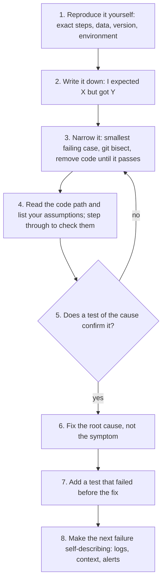

# Debugging

How to find a bug by method instead of by guessing. This page starts from a LinkedIn post on how six well-known engineers debug, checks its claims against primary sources, and ends with one workflow you can follow. For writing code that fails clearly in the first place, see [Error Handling](error_handling.md).

!!! quote "Source"
    Alexandre Zajac, *"I studied how 6 legendary engineers debug code (so you don't have to)"*, LinkedIn, 2026-11-01. <https://www.linkedin.com/posts/alexandre-zajac_i-studied-how-6-legendary-engineers-debug-share-7522695971999412224-6INV/>

!!! note "About the infographic"
    The post's infographic is not copied here because it shows drawn portraits of real people. The table below carries all of its text. The post was read on 2026-11-04.

## What the Post Says

| Engineer | Habit | How to apply (from the post's infographic) |
|---|---|---|
| **John Carmack** | *Methodical isolation:* strip the system down to the smallest failing case and remove variables one by one | Reproduce the bug in the smallest possible scope. Remove code until it works, then add it back line by line. Log state at every boundary |
| **Linus Torvalds** | *Read the code, not the logs:* most bugs come from wrong assumptions, not missing information | Read the actual code path before checking logs. Question every assumption. Trace the execution flow by hand |
| **Margaret Hamilton** | *Defensive thinking:* design for errors before they happen; test what should *not* happen | Write tests for failure modes, not just success paths. Ask "what if this input is wrong?" at every step. Build error recovery into every critical path |
| **Grace Hopper** | *Find the actual bug:* go to the physical source; don't trust second-hand reports | Reproduce the exact conditions before theorizing. Don't trust "it works on my machine". Check the hardware and infrastructure, not just the code |
| **Dan Abramov** | *Explain it to debug it:* write down what the code should do vs what it does; the gap is the bug | Write one sentence: "I expected X but got Y". Rubber-duck the flow out loud. If you can't explain the fix, keep digging |
| **James Gosling** | *Trace everything:* build systems that explain themselves when they fail | Add structured logs at every entry and exit point. Pass correlation IDs across service calls. Make errors self-descriptive, with full context |

The post's conclusion:

> None of them start by guessing. None of them start by Googling the error. None of them start by asking ChatGPT. They all start by understanding. Method > talent.

## Going Deeper

The habits are sound. The attributions are mixed: some match what the person actually said, one is contradicted by the person's own words, one is a myth, and one has no source I could find.

### Isolation: Make the Failing Case Small

A **minimal reproducible example** (*repro*) is the smallest input, code, and environment that still shows the bug. Every line you remove is a suspect ruled out. Two tools do the narrowing mechanically:

- **[`git bisect` ↗](https://git-scm.com/docs/git-bisect)** binary-searches the commit history: mark one commit good and one bad, test the midpoint, repeat. About 10 steps cover 1,000 commits.
- **[Delta debugging ↗](https://en.wikipedia.org/wiki/Delta_debugging)** (Andreas Zeller) automates the same idea for inputs: keep removing parts of a failing input while it still fails.

Carmack and the debugger: the post's "no intuition, just process" fits him, but he is also the strongest *pro-debugger* voice of the six. Replying in 2016 to a blog post titled "I do not use a debugger", he wrote: *"I take the contrary position – aggressive use of a debugger gives you insight you won't get by mere inspection"* (quoted in [brandur.org: _Do_ debug ↗](https://brandur.org/fragments/do-debug)).

### Reading the Code and Questioning Assumptions

The Torvalds attribution matches his words, but the context matters. In a September 2000 Linux kernel mailing list thread about adding a kernel debugger, he wrote ([LKML ↗](https://www.lkml.org/lkml/2000/9/6/132), [full thread on yarchive ↗](https://www.yarchive.net/comp/linux/debuggers.html)):

> I don't like debuggers. Never have, probably never will. I use gdb all the time, but I tend to use it not as a debugger, but as a disassembler on steroids that you can program. … I do not condone single-stepping through code to find the bug.

His argument was about *kernel* development, and he wanted contributors to understand the code well enough not to need single-stepping. Carmack takes the opposite view. Both are right about something. Reading the code and questioning assumptions is the habit that finds the cause. A debugger is the fastest way to *check* an assumption when you're in code you don't know. Use both.

### Defensive Thinking: Design for the Failure Path

Margaret Hamilton led the team that wrote the on-board flight software for Apollo. During the Apollo 11 landing, a series of computer alarms went off about three minutes before touchdown. The computer was being asked to perform more tasks than it should, and the software was built for that case: it raised an alarm and kept only the more important tasks, the ones needed for landing, so the landing could continue ([Wikipedia ↗](https://en.wikipedia.org/wiki/Margaret_Hamilton_(software_engineer))). That is the habit in the post: decide in advance what happens when things go wrong. It's mostly a design habit rather than a debugging one, and the handbook covers it in [Error Handling → Handling Strategies](error_handling.md#handling-strategies) and [Becoming Senior → Design for the Failure Path](../career/becoming_senior.md#design-for-the-failure-path).

### Reproduce It Yourself

The habit is right: reproduce the exact conditions yourself, and don't fix a second-hand description of a bug. The history is wrong. **Grace Hopper did not coin "debugging."** Thomas Edison was already calling small faults in his inventions "bugs" in 1878. The Oxford English Dictionary cites *debugging* for aircraft engine testing in a 1945 article in the Journal of the Royal Aeronautical Society, and J. Robert Oppenheimer used the word in a 1944 letter. In 1947, Hopper's associates on the Harvard Mark II found a moth stuck in a relay and taped it into the log next to *"First actual case of bug being found"*. That was probably a joke, and it shows the term was already in use. The log entry doesn't use the word "debugging" at all ([Wikipedia: Debugging → Etymology ↗](https://en.wikipedia.org/wiki/Debugging), [Wikipedia: Grace Hopper ↗](https://en.wikipedia.org/wiki/Grace_Hopper)).

### Expected vs Actual

The Abramov attribution matches his own writing. In [How to Fix Any Bug ↗](https://overreacted.io/how-to-fix-any-bug/) (overreacted.io, 2025-10-21) he lays out the steps:

0. **Just fix it.** If the cause is obvious, try the fix.
1. **Find a repro.** A repro *"says what to do, what's expected to happen, and what is actually happening"*. It is the test that tells you whether the bug is still there.
2. **Narrow the repro.** Trade it for a smaller or faster one, as long as you're sure it is still the same bug.
3. **Remove everything else.** Cut code until only what's needed to show the bug is left.
4. **Find the root cause.**

His article is built around an AI agent that kept claiming fixes that didn't work, because it had no repro it could check. The same applies when you pair with an AI: give it the repro and the expected vs actual result, not just "it's broken" (see [Tips](../tool_tip/tips.md)).

Explaining the gap out loud is **[rubber duck debugging ↗](https://en.wikipedia.org/wiki/Rubber_duck_debugging)**, named in *The Pragmatic Programmer*: describe the code line by line to someone, or something, and the wrong assumption often surfaces before you finish.

### Make the System Explain Itself

I found no source for attributing this habit to James Gosling. The practice itself is standard observability. Log structured events at service boundaries, pass a correlation ID with every request so its logs can be joined across services, and put context in every error message. See [Becoming Senior → Observability](../career/becoming_senior.md#observability-is-a-property-of-the-pipeline) and [Error Handling → Best Practices](error_handling.md#best-practices).

### The Nine Rules

The post's habits overlap heavily with David J. Agans' book *Debugging: The 9 Indispensable Rules* (2002), which is still the best short treatment of the subject ([debuggingrules.com ↗](https://debuggingrules.com/); rule list from [David A. Wheeler's review ↗](https://dwheeler.com/essays/debugging-agans.html)):

| Agans' rule | Closest habit in the post |
|---|---|
| Understand the system | Torvalds: read the code |
| Make it fail | Hopper: reproduce the exact conditions |
| Quit thinking and look | Gosling: trace everything; Carmack: look in the debugger |
| Divide and conquer | Carmack: isolate the smallest failing case |
| Change one thing at a time | Carmack: remove variables one by one |
| Keep an audit trail | Abramov: write expected vs actual down |
| Check the plug | Torvalds: question every assumption; Hopper: check the infrastructure |
| Get a fresh view | Abramov: explain it out loud |
| If you didn't fix it, it ain't fixed | Hamilton: test the failure path, not just the happy path |

## A Debugging Workflow

The six habits combined into one loop:

Steps 1–2 make the bug real and checkable. Steps 3–5 find the cause by evidence rather than by guessing. Steps 6–8 make sure it stays fixed and is easier to find next time. Write the repro and the expected vs actual result into the [bug report](../process/work_items.md#bug), so whoever picks it up starts at step 3.
