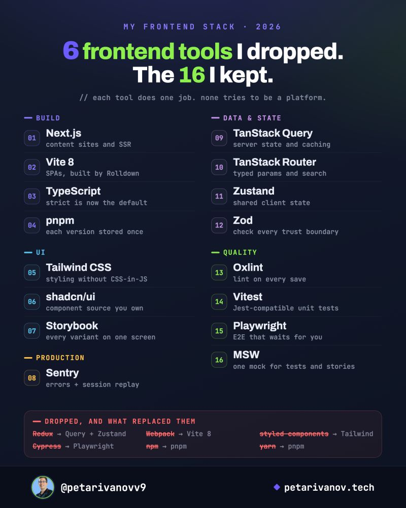

# Frontend Toolchain

A 2026 frontend stack: what one experienced developer dropped, what replaced each tool, and the 16 tools that stayed. The post is the starting point; the sections after it explain *why* each swap happened and when it would be the wrong choice for you.

For the wider picture of languages and stacks, see [Tech Stacks](../basics/tech_stacks.md). For general tool habits, see [Tools](tools.md).

!!! quote "Source"
    Petar Ivanov, *"6 frontend tools I dropped this year (and the 16 I kept)"*, LinkedIn, 2026-10-20. <https://www.linkedin.com/posts/petarivanovv9_6-frontend-tools-i-dropped-this-year-and-activity-7518280845837918208-IrXx>. Read on 2026-10-22.

*Image: © Petar Ivanov ([@petarivanovv9](https://www.linkedin.com/in/petarivanovv9), [petarivanov.tech](https://petarivanov.tech)), from the post above.*

## What the post says

> Every tool on the card does one job and doesn't try to be a platform. That's why I can swap one out without touching the rest.

### Dropped, and what replaced them

| Dropped | Replaced by | Reason given in the post |
|---|---|---|
| **Redux** | TanStack Query + Zustand | Server data moved to TanStack Query, shared client state to Zustand. "Two small tools with one job each beat one store that tries to do both." |
| **Webpack** | Vite 8 | Vite 8 builds with Rolldown, a Rust bundler. SPA builds went from 30+ seconds to under 10, with no separate Babel setup. |
| **styled-components** | Tailwind CSS + shadcn/ui | shadcn/ui copies component source into the repo, so you own it. styled-components went into maintenance mode in March 2025. |
| **Cypress** | Playwright | Playwright waits for elements by itself (no `setTimeout` hacks), and its trace viewer replays a failed run click by click. |
| **npm** and **yarn** | pnpm | pnpm keeps one copy of each package version on the machine. Duplicate `node_modules` went from 40 GB to under 5 GB. |

### The 16 kept

| Area | Tool | Job |
|---|---|---|
| **Build** | Next.js | Content sites and SSR |
| | Vite 8 | SPAs, built by Rolldown |
| | TypeScript | `strict` is now the default |
| | pnpm | Each package version stored once |
| **UI** | Tailwind CSS | Styling without CSS-in-JS |
| | shadcn/ui | Component source you own |
| | Storybook | Every variant on one screen |
| **Production** | Sentry | Errors + session replay |
| **Data & state** | TanStack Query | Server state and caching |
| | TanStack Router | Typed params and search |
| | Zustand | Shared client state |
| | Zod | Check every trust boundary |
| **Quality** | Oxlint | Lint on every save |
| | Vitest | Jest-compatible unit tests |
| | Playwright | E2E that waits for you |
| | MSW | One mock for tests and stories |

Four picks the post singles out:

- **TypeScript 6** turned strict mode on by default. *"Don't turn it off."*
- **Oxlint** finishes in under a second where ESLint took 15, so lint runs on every save.
- **MSW** lets one mock handler serve Vitest, Playwright, and Storybook, so each mock is written once.
- **Sentry** links every production error to a replay of the session. A bug the author had stared at for two hours took 5 minutes to close.

**Next.js *and* TanStack Router?** They never share an app. Next.js runs content sites, and Vite + TanStack runs SPAs.

## Going deeper

### The idea behind every swap

Most of the six swaps share one of three reasons:

| Reason | Swaps |
|---|---|
| **Split one tool that did two jobs** | Redux → Query (server state) + Zustand (client state) |
| **A native-speed rewrite of the same job** | Webpack → Vite 8 / Rolldown (Rust); ESLint → Oxlint (Rust) |
| **Move work from runtime to build time** | styled-components → Tailwind (CSS generated at build, no runtime style injection) |

The Cypress → Playwright and npm → pnpm swaps are simply better tools for the same job.

### Server state vs. client state (Redux → Query + Zustand)

The real lesson isn't "Redux is bad". It's that **data you fetched from a server is a cache, not state you own**. A cache needs things a general store doesn't give you for free: deduplicating identical requests, refetching when stale, retrying, invalidating after a mutation, and pagination. TanStack Query does all of that[^tanstack-query]. What's left over (a modal being open, a theme, a cart draft) is usually small enough for Zustand, React context, or the URL.

**When Redux still fits:** a large app with complex client-side state transitions (editors, offline-first apps), or a team that values Redux DevTools' time-travel debugging. Modern Redux Toolkit with RTK Query also covers the server-cache half[^rtk].

### Bundlers (Webpack → Vite 8)

Vite 8 went stable on **2026-03-12**. It replaced its two previous bundlers (esbuild for development, Rollup for production) with **Rolldown**, one Rust bundler that keeps Rollup's plugin API. The Vite team reports "10–30× faster" than Rollup in benchmarks; Linear's production build went from 46s to 6s[^vite8]. `@vitejs/plugin-react` v6 also dropped Babel as a dependency, which matches the post's "no separate Babel setup".

**When Webpack still fits:** large existing apps that depend on Webpack-only plugins or Module Federation setups that are expensive to migrate. Vite 8 now supports Module Federation too, so check before assuming you're stuck.

### Styling (styled-components → Tailwind + shadcn/ui)

- **Why CSS-in-JS fell out of favour:** runtime libraries like styled-components inject styles while the page renders, which costs time on every render and doesn't fit React Server Components, which render on the server without a client runtime. Tailwind generates plain CSS at build time.
- **styled-components' status:** its maintainer put it into maintenance mode on 2025-03-17 and advised against adopting CSS-in-JS for new projects[^sc-2025]. A March 2026 update reports a working React Server Components setup in a 6.4 release candidate[^sc-2026], so existing users have a way forward. It is still not a choice for a new project.
- **shadcn/ui is not a package you install.** Its CLI copies each component's source into your repo[^shadcn]. You can edit anything, but you also maintain it: upstream fixes don't arrive with `npm update`.

### Testing (Cypress → Playwright, plus Vitest and MSW)

- **Auto-waiting:** Playwright checks an element is visible, stable, enabled, and receiving events before acting, so tests don't need manual sleeps[^pw-wait].
- **Trace viewer:** a failed CI run produces a trace with DOM snapshots, network, and console for every step[^pw-trace]. Turn it on with `trace: 'on-first-retry'` so it only costs time when something fails.
- **More browsers:** Playwright drives Chromium, Firefox, and WebKit (Safari's engine) from one API.
- **MSW** intercepts at the network level: a Service Worker in the browser, request interception in Node[^msw]. So the *same* handler works in unit tests, E2E tests, Storybook, and local development without a fake server.

### Package managers (npm/yarn → pnpm)

pnpm stores every package version once in a **content-addressable store** and hard-links it into each project's `node_modules`[^pnpm]. That's where the 40 GB → 5 GB saving comes from. Its stricter layout also blocks **phantom dependencies**: code can only import packages listed in its own `package.json`, not something a dependency happened to pull in.

### Linting (ESLint → Oxlint)

Oxlint is part of the Oxc toolchain (the same team as Rolldown) and implements hundreds of ESLint rules natively in Rust[^oxlint]. It doesn't yet cover every ESLint plugin. A common setup runs Oxlint on every save and keeps ESLint in CI for the rules Oxlint lacks, with `eslint-plugin-oxlint` turning off the rules that would run twice.

### TypeScript 6: strict by default

TypeScript 6.0 changed the default of `strict` to `true`[^ts6]. If you already set `"strict": true`, nothing changes. If an older project relied on the loose default, upgrading surfaces new errors. Fix them, or set `"strict": false` explicitly and turn the strict flags on one at a time.

### Zod: validate at trust boundaries

TypeScript types disappear at runtime, so they can't protect you from data you didn't write: API responses, form input, URL params, `localStorage`, environment variables. Zod parses unknown data into a typed value or fails loudly[^zod], and its schema can be the single source for both the runtime check and the static type (`z.infer`).

## How to use this list

- **Don't migrate because a post did.** Each swap here fixed a specific pain for the author. Measure your own: build time, lint time, flaky test count, disk usage.
- **Swap one tool at a time** and keep the old one until the new one has run in CI for a while.
- **Cheapest wins first:** pnpm and Playwright are usually low-risk swaps. Redux and styling migrations touch the most code, so do them last and in steps.
- **Check the dates.** Frontend tooling changes fast; this card is a snapshot of October 2026.

## References

[^tanstack-query]: TanStack. *TanStack Query: Overview.* [tanstack.com/query/latest/docs/framework/react/overview](https://tanstack.com/query/latest/docs/framework/react/overview).
[^rtk]: Redux. *RTK Query Overview.* [redux-toolkit.js.org/rtk-query/overview](https://redux-toolkit.js.org/rtk-query/overview).
[^vite8]: Vite Team. *Vite 8.0 is out!* 2026-03-12. [vite.dev/blog/announcing-vite8](https://vite.dev/blog/announcing-vite8).
[^sc-2025]: E. Jacobs. *Thank you.* styled-components on Open Collective, 2025-03-17. [opencollective.com/styled-components/updates/thank-you](https://opencollective.com/styled-components/updates/thank-you).
[^sc-2026]: E. Jacobs. *A Whole New World.* styled-components on Open Collective, 2026-03-27. [opencollective.com/styled-components/updates/a-whole-new-world](https://opencollective.com/styled-components/updates/a-whole-new-world).
[^shadcn]: shadcn. *Introduction.* [ui.shadcn.com/docs](https://ui.shadcn.com/docs).
[^pw-wait]: Playwright. *Auto-waiting.* [playwright.dev/docs/actionability](https://playwright.dev/docs/actionability).
[^pw-trace]: Playwright. *Trace viewer.* [playwright.dev/docs/trace-viewer](https://playwright.dev/docs/trace-viewer).
[^msw]: Mock Service Worker. *Philosophy.* [mswjs.io/docs/philosophy](https://mswjs.io/docs/philosophy).
[^pnpm]: pnpm. *Motivation.* [pnpm.io/motivation](https://pnpm.io/motivation).
[^oxlint]: Oxc. *Oxlint.* [oxc.rs/docs/guide/usage/linter](https://oxc.rs/docs/guide/usage/linter).
[^ts6]: Microsoft. *Announcing TypeScript 6.0.* TypeScript Blog. [devblogs.microsoft.com/typescript/announcing-typescript-6-0](https://devblogs.microsoft.com/typescript/announcing-typescript-6-0/).
[^zod]: Zod. *Intro.* [zod.dev](https://zod.dev/).
